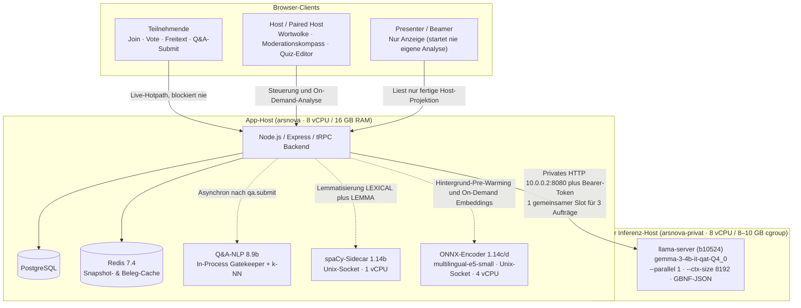

<!-- markdownlint-disable MD013 -->

# Intelligente Textverarbeitung in arsnova.eu: Freitext, Q&A, Lernziele und Moderationskompass

**Zielgruppe:** Product Owner, Lehrende, Entwickler:innen, Betrieb, Studierende (Cloud Computing / Data Analytics)
**Stand:** 2026-10-17
**Kanonische Detaildokumente:** [Moderationskompass (8.9a)](moderation-compass.md) · [Q&A-NLP-Kaskade (8.9b)](qa-nlp-moderation.md) · [Moderationszusammenfassung (8.9c)](qa-summary.md) · [Moderations-Prompt-Kontext (#456)](moderation-prompt-context.md) · [Lernzielableitung (#456 Slice 5)](learning-objective-derivation.md) · [Wortwolken-Glättung mit spaCy (1.14b)](word-cloud-spacy.md) · [Semantische Themenwolke (1.14c/1.14d)](word-cloud-semantic.md) · [Private Open-Weight-LLM-Runtime (8.9d)](open-weight-llm-runtime.md) · [ADR-0032](../architecture/decisions/0032-optional-nlp-cascade-for-qa-moderation-signals.md) · [ADR-0035](../architecture/decisions/0035-self-hosted-llm-runtime-llama-cpp-over-ollama.md) · [ADR-0036](../architecture/decisions/0036-learning-objective-storage-and-live-projection.md)

---

## 1. Leitidee: Warum arsnova.eu fünf getrennte, abschaltbare Stufen statt eines Cloud-LLM-Monolithen nutzt

In einer Vorlesung mit 500 Teilnehmenden entstehen in wenigen Minuten hunderte Freitext-Antworten, Q&A-Fragen, Up-/Downvotes und Tempo-Signale. Lehrkräfte brauchen in diesem Moment **sofortige Orientierung**, ohne dass:

1. **der Live-Hörsaal blockiert** (`join`, `vote.submit`, `qa.submit` und WebSockets dürfen **niemals** auf KI-Inferenz warten),
2. **Teilnehmendendaten an externe Cloud-/SaaS-Anbieter abfließen** (100 % Self-Hosted / On-Premises, keine externen API-Keys in Produktion),
3. **ein Sprachmodell halluziniert oder moderative Entscheidungen übernimmt** (jede Ausgabe ist streng schema- und quellengebunden; die Lehrperson behält immer die Entscheidungshoheit),
4. **der Ausfall eines KI-Bausteins die Veranstaltung stört** (jede Stufe besitzt einen deterministischen, sofort verfügbaren Fallback).

Deshalb folgt die gesamte Textverarbeitung in arsnova.eu einer **mehrstufigen Kaskade** mit **fünf unabhängigen Kill-Switches**:

| Stufe | Baustein                                                   | Aufgabe                                                                                                                         | Technologie / Modell                                                                         | Kill-Switch (Repo-Default: `false`)                         | Fallback bei Aus/Timeout                                                                               |
| :---- | :--------------------------------------------------------- | :------------------------------------------------------------------------------------------------------------------------------ | :------------------------------------------------------------------------------------------- | :---------------------------------------------------------- | :----------------------------------------------------------------------------------------------------- |
| **0** | **Deterministischer Kern**                                 | Wörter-/Phrasen-Wortwolke, Wilson-/Kontroversitäts-Ranking, regelbasierter Moderationskompass (8.9a)                            | Reine TypeScript-Algorithmen (Browser & Backend)                                             | _immer aktiv (Basis)_                                       | —                                                                                                      |
| **1** | **Morphologische Glättung (1.14b)**                        | Flexionsformen in Wortwolken zusammenführen (_»Klausuren«_ → _»Klausur«_)                                                       | Privater `spaCy`-Sidecar (`de`, `en`, `fr`, `es`)                                            | `NLP_ENABLED`                                               | Ungeglättete Originalwörter (`NONE`)                                                                   |
| **2** | **Asynchrone Q&A-Kategorisierung (8.9b)**                  | Jede neue Frage nach `content`, `organization`, `technical` einordnen                                                           | In-Process Hashed-n-Gram Naive Bayes + k-NN-Fallback                                         | `QA_NLP_ENABLED`                                            | Fragen bleiben ohne Kategorie (`unclassified`)                                                         |
| **3** | **Semantisches Themen-Clustering (1.14c/1.14d Stufe 1)**   | Sinngleiche Q&A-Fragen und Freitext-Antworten zu Themen-Clustern bündeln                                                        | Privater ONNX-Sidecar (`intfloat/multilingual-e5-small`) + Complete-Linkage (Kosinus ≥ 0,87) | `WORD_CLOUD_SEMANTIC_ENABLED`                               | Deterministische Phrasen-/Wörterwolke 2.x                                                              |
| **4** | **Private Generative Text-KI (1.14c Stufe 2, 8.9c, #456)** | (a) Kurze Themennamen (`topic_label`), (b) Kompass-Kurzfassung (`qa_summary` V2), (c) Lernzielableitung (`learning_objectives`) | Dedizierter Inferenz-Host mit `llama-server` (`gemma-3-4b-it-qat-Q4_0`, CPU-only, 1 Slot)    | `OPEN_WEIGHT_LLM_ENABLED` (+ `QA_SUMMARY_ENABLED` für 8.9c) | (a) Zentralster Mitgliedstext, (b) Extraktive Kurzfassung aus Top-Quellen, (c) Manuelle Lernzielpflege |

---

## 2. Gesamtarchitektur (Zwei-Host-Produktionstopologie)

**Wichtigste Sicherheits- und Isolationsgarantien:**

- **Kein öffentlicher KI-Port:** `spaCy` und `wordcloud-encoder` laufen mit `network_mode: none` über lokale Unix-Sockets; `llama-server` bindet ausschließlich auf die private RFC1918-Adresse (`10.0.0.2:8080`) und erzwingt Bearer-Token-Authentisierung.
- **Hotpath-Isolation (automatisiert geprüft in `wordCloud.hotpath-isolation.test.ts`):** `vote.ts`, `qa.ts`, `session.ts` und die WebSocket-Handler warten niemals auf Embeddings oder LLM-Antworten.
- **Kein Presenter-Eigenleben:** Der Beamer (`session/.../present`) zeigt exakt die vom Host aktivierte Wortwolke (Wörter, Begriffe & Phrasen oder Thema) in Bühnengröße (`outputOnly`, 30–80 px, max. 24 Begriffe), startet aber niemals selbst einen Analyse- oder LLM-Auftrag.

---

## 3. Säule 1: Intelligente Wortwolke für Freitext (Quiz) und Q&A-Forum

Sowohl die **Freitext-Frage im Quiz** (`channel: 'FREETEXT'`, bis zu 500 sichtbare Antworten) als auch das **Q&A-Forum** (`channel: 'QA'`, bis zu 500 `PINNED`/`ACTIVE`-Fragen) nutzen dieselbe dreistufige Wortwolken-Architektur. Die Lehrkraft schaltet nahtlos zwischen drei Ansichten um:

1. **Wörter (`LEXICAL`, Unigramme):** Häufigste Einzelwörter nach Stopwortfilterung.
2. **Wörter & Phrasen (`THEME` / `PHRASES`):** Erhält zusammengehörige Kurzgruppen (Bi-/Trigramme wie _»Kapitel 4«_, _»lineare Regression«_) statt Sätze in isolierte Einzelwörter zu zerreißen.
3. **Thema (`SEMANTIC`):** Gruppiert sinngleiche Fragen oder Freitext-Antworten auch dann, wenn sie völlig unterschiedliche Wörter benutzen (z. B. _»Der Beamer flackert vorne«_ + _»Projektor hat einen Wackelkontakt«_ → Thema **»Beamer- und Projektorprobleme«**).

### 3.1 Sprachformen glätten (`spaCy`, Story 1.14b)

- In den Modi **Wörter** und **Wörter & Phrasen** kann die Lehrkraft **»Sprachformen glätten«** (`normalization: 'LEMMA'`) ein- und ausschalten.
- Der `spaCy`-Sidecar führt gebeugte Wortformen (_»Funktionen«_, _»Funktion«_) auf ihre Grundform zurück.
- Im Modus **Thema (`SEMANTIC`)** ist dieser Schalter bewusst ausgeblendet, da das mehrsprachige Embedding-Modell Flexionen und Synonyme bereits semantisch erfasst.

### 3.2 Semantisches Clustering (Stufe 1: ONNX `multilingual-e5-small`)

1. **Anonymisierter Input:** An den Encoder gehen ausschließlich `{ id, text }` (mit Präfix `"query: "`). Keine Nicknames, keine Participant-IDs, keine Session-Codes, keine Tokens.
2. **Längensortiertes 16er-Batching (`docker/wordcloud-encoder/embed.py`):**
   - Vor dem Forward-Pass werden die Texte nach Zeichenlänge sortiert, in 16er-Batches auf bis zu 4 CPU-Threads (`intra_op_num_threads = 4`) durch das quantisierte ONNX-Modell geschickt und anschließend exakt in die Originalreihenfolge zurücksortiert.
   - Dadurch werden kurze Fragen/Antworten (10–15 Tokens) nicht auf die Länge eines einzelnen 250-Token-Ausreißers im selben Batch hochgepaddet.
3. **Complete-Linkage-Clustering (`wordCloudSemanticCluster.ts`):**
   - Die L2-normalisierten 384-dimensionalen Vektoren werden deterministisch per Complete-Linkage mit einer Kosinus-Schwelle von **$\ge 0{,}87$** geclustert (Mindestclustergröße: 2 Beiträge, maximal 12 Themen-Cluster).
   - Warum Complete-Linkage bei $0{,}87$? Bei Vorlesungsfragen teilen viele Sätze denselben Rahmen (_»Kurze Frage zu …«_, _»Kann jemand erklären …«_). Average-Linkage würde verschiedene Fachthemen über solche Brückensätze zu einem einzigen Mega-Cluster verketten; Complete-Linkage verlangt, dass _alle_ Mitglieder eines Clusters paarweise $\ge 0{,}87$ ähnlich sind.
4. **Extraktives Basis-Label (Stufe 1):**
   - Jedes Cluster erhält sofort als sicheres Basis-Label denjenigen Mitgliedstext, der dem Cluster-Zentroiden am nächsten liegt (bei Gleichstand den kürzesten Text). Selbst ohne LLM ist die Themenwolke damit sofort einsatzbereit.

### 3.3 Kurze KI-Themennamen (Stufe 2: `topic_label` auf Gemma 3 4B QAT)

Wenn zusätzlich `OPEN_WEIGHT_LLM_ENABLED=true` aktiv ist, ersetzt `applyWordCloudTopicLabels` (`wordCloudTopicLabels.ts`) die langen Fragesätze der bis zu 12 Cluster durch kurze, im Hörsaal sprechbare Nominalphrasen (2–6 Wörter):

- **Repräsentative Quellenauswahl & Kurz-IDs:** Pro Cluster werden höchstens die **6 zentralsten Beiträge** (`TOPIC_LABEL_MAX_SOURCES_PER_CLUSTER = 6`, je max. 240 Zeichen) mit kompakten Quell-IDs (`s1`..`s6` bzw. `qa-1`..`qa-6`) gepackt.
- **Multi-Cluster-Batching (`schemaVersion: 2`):** Liegen mindestens 2 unbenannte Cluster vor, werden sie in **einem einzigen Sammelauftrag** (`OpenWeightLlmTopicLabelBatchRequestSchema`, bis 2.500 UTF-8-Bytes) an `llama-server` gesendet. Dadurch wird der Systemprompt nur 1× statt 12× verarbeitet und `llama.cpp` berechnet den Prompt-Prefill parallel in einem Matrix-Durchlauf (Live-Messung auf `arsnova-privat`: **6 Cluster komplett in 22,9 s**).
- **Strenge Annahmeregeln (`acceptLabel` & Referenzprüfung):**
  - Ein Modellname wird nur übernommen, wenn er 1–80 Zeichen lang ist, höchstens 6 Wörter hat, keinen Zeilenumbruch enthält, kein bloßes Echo eines Mitgliedstextes ist und ausschließlich erlaubte `sourceIds` seines Clusters zitiert.
  - Scheitert ein Cluster-Name (oder läuft das Phasenbudget aus), behält genau dieses Cluster seinen extraktiven Mitgliedstext aus Stufe 1 (`labelOrigin: 'extractive'`), während alle anderen Cluster ihren Modellnamen (`labelOrigin: 'model'`) behalten.

### 3.4 Die 5 Hochgeschwindigkeits-Optimierungen für den Live-Hörsaal

Damit die Themen-Ansicht bei 500 Q&A-Fragen oder einer dynamischen Live-Freitextfrage im Quiz ohne Wartezeit reagiert, greifen fünf Caches und Lebenszyklus-Regeln ineinander:

1. **Stilles Hintergrund-Pre-Warming (`wordCloudPrewarmQueue.ts` → `scheduleWordCloudSemanticEmbeddingPrewarm`):**
   - Sobald Teilnehmende eine Q&A-Frage einreichen (`qa.submit`, `qa.redactPassages`) oder eine Freitext-Antwort abgeben (`vote.submit`), wird der Text entkoppelt in einen gedrosselten Hintergrund-Puffer (`1.500 ms` Debounce) eingereiht.
   - Solange der Encoder-Sidecar frei ist, berechnet er die Einzel-Embeddings bereits während die Abstimmung noch läuft. Klickt der Host am Ende auf **»Ergebnis anzeigen«** oder **»Thema«**, liegen die Vektoren bereits fertig im RAM (**0 ms** Encoder-Wartezeit).
2. **Inkrementeller Einzel-Embedding-Cache (`sessionItemEmbeddingsCache`):**
   - Jedes berechnete Text-Embedding wird session-gescopet unter `SHA-256(locale, sourceText)` im Speicher gehalten (plus Deduplizierung identischer Antworten innerhalb eines Schubs). Kommen zu 200 Antworten noch 30 neue hinzu, werden beim Klick auf **»Themen aktualisieren«** (auch bei `refresh: true`) nur noch die 30 neuen Texte durch ONNX geschickt.
3. **Gewichtsunabhängiger Session-Cluster-Cache (`sessionClustersCache`):**
   - Da E5-Embeddings und Complete-Linkage-Rohcluster ausschließlich von `{ id, text }` abhängen – und **nicht** von der gewählten Sortierung (`BEST`, `CONTROVERSIAL`, `TIME`, `TOP`) –, speichert `wordCloudSemanticAnalyze` die Roh-Cluster unter einem gewichtsunabhängigen Korpus-Hash.
   - Wechselt der Host im 500-Fragen-Forum zwischen _Beste Fragen_, _Kontroverse_, _Stimmensaldo_ und _Zeit_, wird der Encoder komplett übersprungen und die Cluster werden in **< 1 ms** mit den neuen Gewichten neu sortiert.
4. **Session-gescopeter Topic-Label-Cache (`clusterTopicLabelCache`):**
   - Jedes vom LLM erzeugte Cluster-Label wird unter `session:<sessionId>:<sha256(model, version, locale, sources)>` für 30 Minuten gecacht.
   - Weder ein Sortierwechsel noch ein vorheriges Teil-Timeout (`labelSettlement: 'transient'`) noch neu hinzukommende Antworten (solange die Top-6-Repräsentanten eines Clusters stabil bleiben) lösen einen erneuten LLM-Aufruf aus (**0 ms**).
5. **Automatisches Nachziehen bei »Ergebnis anzeigen« (`RESULTS`) & sofortiger Abbruch (`AbortSignal`):**
   - Springt der Host bei einer laufenden Freitext-Frage vor Ablauf des Countdowns auf **»Ergebnis anzeigen«**, maximiert sich die Wortwolke automatisch; war eine frühere Themen-Analyse aus der `ACTIVE`-Phase durch letzte Antworten veraltet (`stale`), zieht der Host den eingefrorenen Endstand genau einmal automatisch nach.
   - Verlässt der Host dagegen die Session-Ansicht (z. B. zurück zur Startseite) oder beendet die Session, bricht `wordCloudHttpAbortController.abort()` über den ungebündelten `httpLink` und `createRequestDisconnectSignal` den laufenden `llama-server`-Aufruf sofort ab, sodass der Einzel-Slot frei wird.

---

## 4. Säule 2: Q&A-NLP-Kaskade (Story 8.9b)

Unabhängig von der Wortwolke kann jede eingereichte Q&A-Frage im Hintergrund automatisch einer von drei Moderationskategorien zugeordnet werden:

- **`content` (Inhaltlich):** Fachfragen zum Vorlesungsstoff.
- **`organization` (Organisatorisch):** Fragen zu Klausurterminen, Folien, Moodle, Anwesenheit.
- **`technical` (Technisch):** Hinweise zu Mikrofon, Beamer, Stream oder WLAN.

**Technischer Ablauf (`qaNlpWorker.ts` / `qaNlpQueue.ts`):**

- Nach `qa.submit` wird die Frage sofort in PostgreSQL gespeichert; erst danach reiht `enqueueQaNlpJob` sie in eine asynchrone In-Process-Queue ein.
- **Stufe 1 (Gatekeeper):** Ein schneller Hashed-n-Gram-Naive-Bayes-Klassifikator (`gatekeeper-hash-nb-v1`) bewertet den Text in wenigen Mikrosekunden. Liegt die Konfidenz über der kalibrierten Early-Exit-Schwelle, ist die Frage sofort klassifiziert.
- **Stufe 2 (k-NN-Fallback):** Liegt die Konfidenz darunter, prüft ein In-Process-k-NN-Klassifikator (`fallback-knn-v1`) im selben Feature-Raum. Bleibt die Konfidenz unter `QA_NLP_MIN_CONFIDENCE` (`0.55`), wird `uncertain` gespeichert.
- **Wichtig:** Story 8.9b läuft komplett in-process im Node-Backend und belegt **niemals** den `llama-server`-Slot.

---

## 5. Säule 3: Modellgestützte Lernzielableitung (Issue #456 Slice 4 & 5)

Gute Moderation im Hörsaal hängt davon ab, _was_ die Studierenden in der aktuellen Sitzung eigentlich lernen sollen. arsnova.eu unterstützt deshalb explizite, prüfbare **Lernziele** (sowohl für ein gesamtes Quiz als auch für einzelne Quiz-Abschnitte oder reine Q&A-Sessions):

1. **Vorbereitungsauftrag (`quiz.deriveLearningObjectives`):**
   - Im Quiz-Editor kann die Lehrkraft bewusst **»Lernziele vorschlagen«** auslösen. Die Oberfläche zeigt währenddessen einen kleinen Kreisindikator für die lebende Abfrage, einen bestimmten Balken mit Skala der fertigen Fragegruppen und nach der ersten Gruppe eine grobe Restdauer. Einen vorzeitigen Abbruch erklärt sie mit Grund, Dauer und bisherigem Textumfang.
   - Dabei werden die Fragenstämme, Antwortoptionen, Musterlösungen und Lösungserklärungen in deterministischen Batches (≤ 2.500 UTF-8-Bytes pro Batch) an die private Runtime (`taskType: 'learning_objectives'`, Prompt `learning-objectives-system-v4`) übergeben.
   - Das Modell formuliert kurze, rollenneutrale Infinitivphrasen (z. B. _»Lineare Regressionsmodelle auf Stichprobendaten anwenden.«_) mit großgeschriebenem Anfangswort und muss jedes Lernziel mit mindestens einer exakten `questionId` aus dem Request belegen. Diese ID steht nur im Feld `questionIds`. Kleingeschriebene Modellausgaben werden nachträglich großgeschrieben. Steht eine dieser IDs zusätzlich im Satz eines Modellvorschlags, wird nur sie entfernt; andere Kennungen bleiben stehen. Fehlende Schlusspunkte werden ergänzt.
2. **Menschliche Bestätigung & Lebenszyklus ([ADR-0036](../architecture/decisions/0036-learning-objective-storage-and-live-projection.md)):**
   - Alle vom Modell gelieferten Ziele starten als **Entwürfe (`derived`, unbestätigt)**.
   - Die Lehrkraft kann sie bearbeiten, bestätigen (`confirmed`), verwerfen oder manuell eigene Ziele (`manual`) anlegen.
   - Eine erneute Ableitung oder ein Modellwechsel überschreibt **niemals** bereits bestätigte oder manuelle Lernziele. Ändert die Lehrkraft später eine verknüpfte Quizfrage oder deren Lösung, wird das zugehörige Lernziel als **überprüfungsbedürftig (`needsReview`)** markiert.
3. **Strikte Lösungstrennung im Live-Betrieb:**
   - Während der Vorbereitung darf die Lernzielableitung die Musterlösungen sehen.
   - Im späteren Live-Moderationskontext einer laufenden Session werden jedoch ausschließlich die kompakten Lernzieltexte und Aufgabenreferenzen übertragen – **niemals** Lösungsschlüssel (`isCorrect`) noch nicht freigegebener Fragen.

---

## 6. Säule 4: Moderationskompass (8.9a) & Generative Kurzfassung (8.9c / #456)

Der **Moderationskompass** ist das zentrale Entscheidungswerkzeug für die Lehrkraft während einer laufenden Session. Er verbindet drei Schichten:

### 6.1 Schicht 1: Deterministischer Regelkern (Story 8.9a – immer verfügbar)

Ohne jedes KI-Modell wertet `buildModerationCompassCards` (`moderation-compass.ts`) die aktuellen Live-Signale der Session aus und erzeugt quellenbelegte Hinweiskarten sowie genau einen priorisierten **nächsten Handlungsschritt**:

- **Tempo- & Blitzlicht-Signale:** Wenn z. B. im Tempo-Blitzlicht ein relevanter Anteil _»Zu schnell«_ oder _»Ich komme nicht mehr mit«_ meldet.
- **Reibung / Kontroverse im Q&A:** Fragen mit hohem Kontroversitäts-Score (viele Up- _und_ Downvotes gleichzeitig).
- **Klärungsbedarf / Top-Anliegen:** Stark unterstützte, noch unbeantwortete oder angeheftete Fragen (`Best-Score` / Wilson-Score) sowie erkannte Kategorien aus 8.9b (`content`, `organization`, `technical`).
- **Quiz-Ergebnisindikatoren (erst nach Ergebnisfreigabe `RESULTS`):** Niedrige Trefferquote, starke Antwortstreuung und, wenn die Selbsteinschätzung an war, **selbstsicher falsch** als mögliches Fehlkonzept. Eine wiederkehrende falsche Option ab 30 % der Antworten mit Selbsteinschätzung wird Klärung und kann den nächsten Schritt bestimmen. Darunter oder ohne benennbare Option bleibt es eine Erwähnung.

Jede Karte verweist direkt auf ihre konkreten Quellen (Sprung zur Q&A-Frage, zur Wortwolke oder zur Quiz-Auswertung).

### 6.2 Schicht 2: Der autorisierte, budgetierte Moderations-Prompt-Kontext (`ModerationPromptContextV1`, Issue #456)

Wenn die Lehrkraft im Kompass zusätzlich den Block **»Kurzfassung der offenen Fragen«** öffnet und auf **»Zusammenfassung«** klickt (`qa.requestSummary`), baut das Backend (`moderationSummaryContext.ts`) einen streng kontrollierten, lösungsfreien Snapshot (`ModerationPromptContextV1`) aus zehn Bereichen auf:

1. **`meta` & `scope`:** Schema-/Auswahlversionen, Kanal, Phase, Raumbezugsgröße für Kontroversität, Gesamt- vs. Analyseumfang.
2. **`questions`:** Deterministisch priorisierte Q&A-Fragen mit echten Positiv-/Negativstimmen (getrennt vom Nettoscore), Best-Score, Kontroversität, Status (`PENDING`/`ACTIVE`/`PINNED`) und 8.9b-Kategorie.
3. **`topics`:** Aktuelle semantische Themen-Cluster aus dem internen Latest-Themenbeleg (`qaSemanticTopicSnapshot.ts`), derentexte frisch gegen PostgreSQL revalidiert werden.
4. **`compass`:** Die regelbasierten Kompasskarten und der regelbasierte Handlungsvorschlag.
5. **`learningContext`:** Bestätigte und aktive Lernziele der Session bzw. aktuellen Frage.
6. **`releasedResults` & `feedback`:** Ausschließlich bereits freigegebene Quiz-Aggregate und Blitzlicht-/Tempo-Verteilungen.
7. **`sources` & `budget`:** Typisiertes Quellenregister (`q1`, `t1`, `c1`, `l1`, `r1`, `f1`) und der exakte Token-/Byte-Budgetbericht (8.192-Profil mit 640 Tokens Antwortreserve, 128 Tokens Sicherheitsmarge und max. 2.811 UTF-8-Bytes für das kanonische Kontext-JSON).

Über **Diagnose → Kontextvorschau laden** (`qa.summaryContextPreview`) kann die Lehrkraft jederzeit transparent einsehen, welche Bereiche, Quellenmengen und eventuellen Budgetkürzungen in den Kontext eingeflossen sind.

### 6.3 Schicht 3: Generative Kurzfassung (`qa_summary` V2) & Extraktiver Queue-Fallback

Für die Erstellung der Zusammenfassung handelt `qaSummaryRuntimeAdapter.ts` den besten verfügbaren Pfad aus:

1. **Generativer `full-context`-Pfad (`OPEN_WEIGHT_LLM_ENABLED=true`):**
   - `llama-server` erhält exakt drei Nachrichten:
     - `system`: Technische Instruktion (`qa-summary-technical-handoff-v2`, 314 UTF-8-Bytes: einzeiliges JSON, ausschließlich `included`-Quellen zusammenfassen, keine Metadaten über ausgelassene Bereiche wiederholen).
     - `system`: Maschinenlesbares Bedeutungslexikon (203 UTF-8-Bytes: z. B. `PENDING` = Freigabestatus, nicht Lernrückstand; `bestScore` = Wilson-Untergrenze, nicht fachliche Qualität).
     - `user`: Das kanonische JSON des gepackten Fachkontexts.
   - Das GBNF-Ausgabeschema (`qa-summary-model-output-v3`) erzwingt **2–4 prägnante Aussagen (`statements.max(4)`)**, höchstens **2 nächste Schritte (`suggestedNextSteps.max(2)`)** und höchstens **2 Hinweise (`limitations.max(2)`)**, jeweils mit Pflicht-`sourceIds`.
2. **Strenge Vor- und Nachvalidierung (`qaSummaryQueue.ts` & `qaSummaryValidateV2.ts`):**
   - Vor _und_ nach dem LLM-Lauf wird der autorisierte Kontext-Hash geprüft. Wurde während der ~55 Sekunden Rechenzeit eine Frage gelöscht, geschwärzt, archiviert oder die Berechtigung entzogen, wird die Modellantwort verworfen.
   - Jede `sourceId` in der Modellantwort muss im gepackten Quellenregister existieren; unbelegte Aussagen werden entfernt.
   - Auch nach dem Ende einer Live-Session kann der Host während der **14-tägigen Nachbereitungsfrist** (`assertQaHostContentReadAllowed`) noch Zusammenfassungen zur Nachbereitung anfordern.
3. **Deterministischer `extractive`-Fallback (sofort verfügbar, auch ohne LLM):**
   - Ist `OPEN_WEIGHT_LLM_ENABLED=false`, der `llama-server`-Slot gerade durch einen anderen Auftrag belegt oder läuft ein Timeout auf, erzeugt die Backend-Queue sofort eine quellengebundene extraktive Zusammenfassung in allen fünf unterstützten Sprachen (`de`, `en`, `fr`, `es`, `it`). Die Lehrkraft sieht niemals eine leere Fehlerkarte.

---

## 7. Gemeinsame Slot-Orchestrierung und reale Produktionsmesswerte (`arsnova` + `arsnova-privat`)

Da `llama-server` auf dem dedizierten 8-Core-ARM-Inferenzhost (`arsnova-privat`, 8 GiB RAM / 10 GiB RAM+Swap) mit `--parallel 1` genau **einen** Inferenz-Slot besitzt, teilen sich alle drei generativen Aufträge (`topic_label`, `qa_summary`, `learning_objectives`) eine gemeinsame Inflight-Sperre (`openWeightLlmClient.ts`) plus eine vorab ausgeführte Slot-Sonde (`GET /slots?fail_on_no_slot=1`):

- **Kein unsichtbares Queueing hinter `llama-server`:** Ist der Slot belegt, fallen Live-Aufträge (`topic_label`, `qa_summary`) sofort auf ihre extraktiven Fallbacks zurück; der Vorbereitungsauftrag `learning_objectives` meldet einen klaren `busy`-Status mit manuellem Retry.
- **1,5-s-Slot-Cooldown nach Abbruch/Timeout:** Wurde ein Request abgebrochen (z. B. weil der Host die Seite verlassen hat oder ein Probe-Budget griff: 20 s für `topic_label`, höchstens 90 s für `learning_objectives`), wartet der Client vor dem nächsten sequenziellen Aufruf `1.500 ms`, damit `llama-server` den abgebrochenen Slot sauber freigeben kann.
- **Ungebündelter HTTP-Transport (`shouldUseUnbatchedHttpTransport` in `trpc.client.ts`):** Langlaufende KI-Prozeduren (`health.openWeightLlmProbe`, `quiz.deriveLearningObjectives`, `wordCloud.analyze`, `wordCloud.analyzeQa`) werden im Frontend niemals über `httpBatchLink` mit schnellen UI-Queries (wie `health.stats`) gebündelt. Der Dialog **Betrieb & Nutzung** öffnet dadurch in **~150 ms**, während die Live-Prüfung der lokalen Text-KI unabhängig im Hintergrund läuft.

### Zusammenfassung der realen Laufzeitmessungen (Stand: 17.10.2026)

| Szenario (500 Fragen / Antworten, 2-Host-Architektur)                                         | Vor den Optimierungen                                      | Aktueller Stand (mit PR #576–#579)                                   | Maßgebliche Optimierung                                                                                   |
| :-------------------------------------------------------------------------------------------- | :--------------------------------------------------------- | :------------------------------------------------------------------- | :-------------------------------------------------------------------------------------------------------- |
| **Q&A-Themenwolke: Wechsel der Sortierung** (`BEST` ↔ `TOP` ↔ `TIME` ↔ `CONTROVERSIAL`)       | ~148 s pro Wechsel (**10–15 Min.** für alle 4 Ansichten)   | **< 5 Millisekunden**                                                | `sessionClustersCache` + `clusterTopicLabelCache` (kein erneuter Encoder- oder LLM-Lauf)                  |
| **Live-Freitext / Q&A: Klick auf »Thema« oder »Ergebnis anzeigen« nach laufendem Einreichen** | ~60 s ONNX + ~90 s LLM                                     | **0 ms ONNX** + **~15–22 s LLM** (für neue Cluster)                  | Hintergrund-Pre-Warming (`wordCloudPrewarmQueue`) + `sessionItemEmbeddingsCache`                          |
| **Kaltstart: 6 unbenannte Themen-Cluster durch `Qwen3-4B` benennen**                          | ~45–90 s (6 Einzel-Calls, häufige UUID-Token-Abbrüche)     | **22,9 Sekunden** (`411` Prompt- / `179` Completion-Tokens)          | Multi-Cluster-Batching (`schemaVersion: 2`) + kompakte Quell-IDs (`s1`..`s6`)                             |
| **Kaltstart: 500 uncached Texte im ONNX-Encoder (`e5-small`)**                                | ~60 s (1 vCPU, unsortiertes Padding)                       | **~8–12 Sekunden**                                                   | Längensortierte 16er-Batches (`embed.py`) + 4 CPU-Threads (`docker-compose.prod.yml`)                     |
| **Q&A-Moderationszusammenfassung (`qa.requestSummary` V2)**                                   | > 90 s (Timeout bei 640 Tokens, `finish_reason: "length"`) | **56,9 Sekunden** (`374` Completion-Tokens, `finish_reason: "stop"`) | `qa-summary-technical-handoff-v2` (einzeilig, nur `included`) + `qa-summary-model-output-v3` (Caps 4/2/2) |
| **Öffnen des Dialogs »Betrieb & Nutzung« (`health.stats` parallel zu `openWeightLlmProbe`)**  | ~70–95 s blockiert                                         | **~150 Millisekunden**                                               | `health.openWeightLlmProbe` im ungebündelten `httpLink`                                                   |
