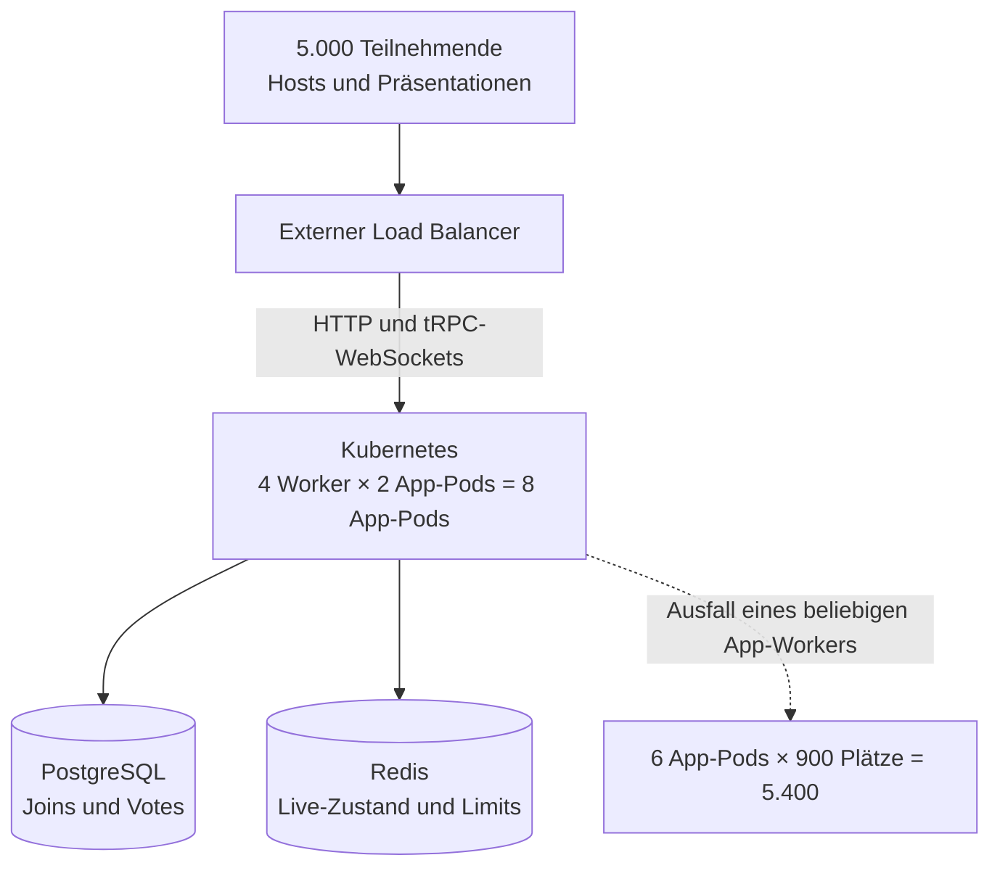
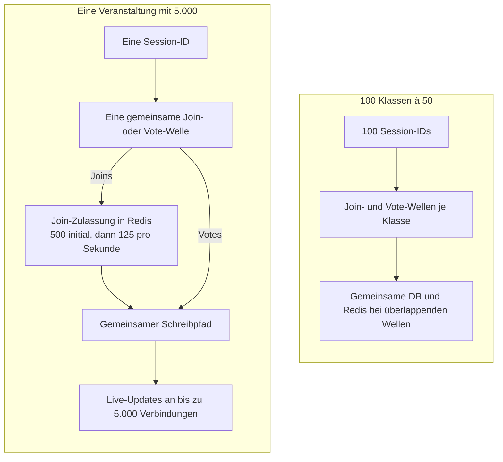

# Kubernetes-Dimensionierung für 5.000 Teilnehmende

Stand 23. November 2026 · Basis [`7bfa8282`](https://github.com/kqc-real/arsnova.eu/commit/7bfa8282e37eabab1eed8b831af5850128b06f17)

**Startgröße für den Lasttest sind acht App-Pods auf vier Kubernetes-Workern.** Mit je einem separaten Rechner für PostgreSQL und Redis sind das **sechs Rechner mit zehn Anwendungs- und Daten-Pods**. Die Verbindungsrechnung gilt für 100 Klassen à 50 Personen und für eine Veranstaltung mit 5.000 Personen. Der große Einzelraum braucht ein höheres WebSocket-Limit je Session. Mit der heutigen Join-Zulassung liegt die rechnerische Untergrenze für den p95 einer synchronen 5.000er-Join-Welle bei **34 Sekunden**.

## Pod- und Rechnerrechnung

Die Rechnung setzt eine WebSocket-Verbindung je teilnehmendem Browser und zwei weitere je Session für Host und Präsentation an. Das entspricht dem [vorhandenen Lastprofil](MULTI-INSTANCE-PLAN.md#lokaler-vergleich-mit-einer-und-zwei-apps-am-19-november-2026), das bei 30 Klassen à 30 Personen 960 Verbindungen hielt. Das [konfigurierte Prozesslimit](https://github.com/kqc-real/arsnova.eu/blob/7bfa8282e37eabab1eed8b831af5850128b06f17/apps/backend/src/lib/trpcWebSocketServer.ts#L47-L75) liegt bei 1.200. Als Planungswert werden **900 aktive Sockets je App-Pod** angesetzt, also 75 % dieses Limits. Die Verteilung setzt je Worker zwei gleich ausgestattete App-Pods und einen gleichmäßig belasteten App-Pool voraus.

| Rechnung                                                | 100 × 50               | 1 × 5.000              |
| ------------------------------------------------------- | ---------------------- | ---------------------- |
| WebSockets mit Host und Präsentation                    | 100 × (50 + 2) = 5.200 | 5.000 + 2 = 5.002      |
| Minimum aus dem Pod-Limit nach Anhebung globaler Limits | ⌈5.200 / 1.200⌉ = 5    | ⌈5.002 / 1.200⌉ = 5    |
| Pods beim Planungswert von 900 Sockets                  | ⌈5.200 / 900⌉ = 6      | ⌈5.002 / 900⌉ = 6      |
| Bereitstellung mit Reserve für einen Worker-Ausfall     | 4 × 2 = **8 App-Pods** | 4 × 2 = **8 App-Pods** |
| Sockets je Pod nach Ausfall eines Workers, aufgerundet  | ⌈5.200 / 6⌉ = 867      | ⌈5.002 / 6⌉ = 834      |
| Freie Plätze beim Planungswert nach dem Ausfall         | 5.400 − 5.200 = 200    | 5.400 − 5.002 = 398    |

| Aufbau               | Rechner / VMs | Anwendungs- und Daten-Pods            |
| -------------------- | ------------: | ------------------------------------- |
| Datenhaltung einzeln |         **6** | **10** · 8 App, 1 PostgreSQL, 1 Redis |
| Je ein Daten-Standby |         **8** | **12** · 8 App, 2 PostgreSQL, 2 Redis |

Für den Test sind je App-Worker **8 vCPU und 16 GiB RAM** angesetzt, in der Größenklasse des bisherigen Zielhosts. Das ergibt 32 vCPU und 64 GiB auf der App-Ebene, nach einem Worker-Ausfall 24 vCPU und 48 GiB. Die Datenrechner werden nach Schreiblast, Pool-Wartezeit und Redis-Latenz dimensioniert. Für die Standby-Variante kommen Replikation und getestetes Failover hinzu. Die Stückliste zählt die Live-Anwendung und ihre beiden Datenpfade bei verwalteter Control Plane und externem Load Balancer. Yjs-Relay, PDF-Worker, Textanalyse, Modellserver und Infrastruktur-Pods werden nach Funktionsumfang zusätzlich dimensioniert. [Zielhost und Messbedingungen](TARGET-HOST-LOAD-2026-11-20.md#messbedingungen) · [Kubernetes-Pod-Verteilung](https://kubernetes.io/docs/concepts/scheduling-eviction/topology-spread-constraints/) · [Produktionsrollen](PRODUCTION-REPLICAS.md)

## Wo sich die Lastprofile unterscheiden

- **100 × 50.** Mehr App-Pods verteilen unabhängige Sessions und neue Verbindungen über mehr Prozesse. Die wichtigste Lastvariable ist die Zahl der gleichzeitig abstimmenden Klassen. Die Planung muss versetzte und vollständig überlappende Wellen getrennt prüfen.
- **1 × 5.000.** Neue Verbindungen und die Zustellung von Statusupdates verteilen sich auf mehrere App-Pods. Ein synchroner Join, Vote oder Fragewechsel konzentriert den DB- und Redis-Zugriff auf dieselbe Session. Die vorhandenen [Vote-Batches](https://github.com/kqc-real/arsnova.eu/blob/7bfa8282e37eabab1eed8b831af5850128b06f17/apps/backend/src/lib/choiceVoteBatch.ts#L34-L56) koordinieren Schreibvorgänge über PostgreSQL. Skalierungsgewinn und Reihenfolge des Ausbaus hängen hier von Pool-Wartezeit, DB-Transaktionsdauer und der Zustellzeit des Statuswechsels ab.

## Grenzen vor dem Lasttest

| Grenze                                    | Aktueller Stand         | Testwert oder Änderung                                                                            |
| ----------------------------------------- | ----------------------- | ------------------------------------------------------------------------------------------------- |
| `TRPC_WS_CLUSTER_MAX_CONNECTIONS`         | 2.100, Code-Max. 10.000 | 8.000 für beide Profile                                                                           |
| `TRPC_WS_MAX_CONNECTIONS_PER_SESSION`     | 1.100, Code-Max. 5.000  | 100 × 50 passt. Für 1 × 5.000 das Code-Maximum erhöhen und 8.000 testen.                          |
| `TRPC_WS_CLUSTER_MAX_UPGRADES_PER_MINUTE` | 6.000, Code-Max. 60.000 | 12.000 als Testwert für Erstaufbau und eine weitere volle Verbindungswelle innerhalb einer Minute |

Die Grenze von 8.000 lässt Platz für Neuverbindungen nach Ausfall eines Workers, während dessen bis zu 2.400 alte Verbindungsreservierungen noch gezählt werden. Im größeren der beiden Fälle ergibt das höchstens `5.200 + 2.400 = 7.600` unter dieser Annahme. Für eine vollständige Neuverbindung aller Clients bei gleichzeitig noch gezählten Altverbindungen wären bis zu 10.400 Plätze nötig. Eine solche Welle verlangt gestaffelte Reconnects oder eine gesondert getestete höhere Grenze. [Grenzwerte im Code](https://github.com/kqc-real/arsnova.eu/blob/7bfa8282e37eabab1eed8b831af5850128b06f17/apps/backend/src/lib/trpcWebSocketServer.ts#L47-L75) · [Redis-Reservierungen und Ablauf](https://github.com/kqc-real/arsnova.eu/blob/7bfa8282e37eabab1eed8b831af5850128b06f17/apps/backend/src/lib/trpcWebSocketClusterBudget.ts#L14-L30)

### Gemeinsame Join-Zulassung

`session.join` wartet vor dem Schreiben des Teilnahmedatensatzes auf eine Zulassung. In Redis gilt pro Session **ein Token-Bucket für alle App-Pods**. Ein voller Bucket lässt zunächst 500 Joins zu und füllt danach 125 Plätze pro Sekunde nach. Bei 100 Klassen à 50 passt jede Klassenwelle in ihren eigenen vollen Bucket. [Aufruf in `session.join`](https://github.com/kqc-real/arsnova.eu/blob/7bfa8282e37eabab1eed8b831af5850128b06f17/apps/backend/src/routers/session.ts#L10803-L10820) · [Redis-Bucket](https://github.com/kqc-real/arsnova.eu/blob/7bfa8282e37eabab1eed8b831af5850128b06f17/apps/backend/src/lib/joinAdmission.ts#L4-L36)

Bei einem synchronen Start in einem Raum braucht die `k`-te Zulassung unter idealen Bedingungen mindestens `max(0, (k − 500) / 125)` Sekunden. Für das p95 zählt die Zulassung mit Rang `⌈0,95 × Zahl der Joins⌉`. Die Rechnung setzt einen vollen Bucket beim Start und regulären Redis-Betrieb voraus. Transport, Wiederholungsintervalle der Zulassungsprüfung und DB-Zeit kommen hinzu.

| Gleichzeitige Joins in einer Session | Untergrenze für die p95-Zulassung | Untergrenze für die letzte Zulassung |
| -----------------------------------: | --------------------------------: | -----------------------------------: |
|                                  500 |                               0 s |                                  0 s |
|                                1.000 |                             3,6 s |                                  4 s |
|                                2.500 |                              15 s |                                 16 s |
|                                5.000 |                          **34 s** |                             **36 s** |

Wer das Join-Ziel von **p95 unter 1 s** auf synchrone Starts ab 1.000 Personen überträgt, muss eine erweiterte Join-Zulassung separat testen. Weitere App-Pods teilen denselben Bucket. Bei einer gestaffelten Ankunft sind Ankunftsrate, Dauer bis zum vollständigen Beitritt und p95 pro Anfrage als eigene Abnahmegrößen festzulegen. [Live-SLOs für den 500er-Burst](../implementation/S6.5-SECURITY-LOAD-ACCEPTANCE.md#verbindliche-produkt-slos)

### Gemeinsame Dienste

Alle App-Pods nutzen dieselben Schlüssel, dieselben PostgreSQL- und Redis-Dienste sowie `SESSION_STATUS_PUBSUB_ENABLED=true` und `TRPC_WS_SHARED_LIMITS_ENABLED=true`. HTTP und tRPC-WebSockets werden ohne IP-Affinität verteilt, damit eine Klasse hinter einem Schul-NAT auf mehrere Pods gelangen kann. Migration und Rollout-Bereinigung laufen einmal je Release. Die Session-Retention erhält genau einen Scheduler. Das DB-Verbindungsbudget gilt für alle App-Pods zusammen. Der bisherige Vergleich nutzte insgesamt 60 Verbindungen. Die Zahl je Pod muss für acht Pods, Rollout-Überlappung und Betriebsreserve neu festgelegt werden. [Replikabetrieb](PRODUCTION-REPLICAS.md) · [Ingress und gemeinsamer Zustand](MULTI-INSTANCE-PLAN.md)

## Erwartete Gewinne und Messwerte

| Gewinn                         | Erwartung für die Testtopologie                                                                                                                                    |
| ------------------------------ | ------------------------------------------------------------------------------------------------------------------------------------------------------------------ |
| App-Kapazität für Verbindungen | 8 × 900 = **7.200** geplante Plätze gegenüber rund 5.200 benötigten Plätzen                                                                                        |
| App-Reserve bei Worker-Ausfall | **75 %** der geplanten App-Kapazität bleiben verfügbar. Clients am ausgefallenen Worker verbinden sich neu.                                                        |
| Lastverteilung                 | Mehr unabhängige Klassen können parallel arbeiten. Der gemeinsame DB- und Redis-Durchsatz begrenzt den Gewinn bei überlappenden Wellen.                            |
| Latenz im großen Raum          | Mehr Kapazität für die Zustellung von Live-Updates. Die gemeinsame Join-Zulassung begrenzt den synchronen Start. Die Vote-Latenz hängt am gemeinsamen Schreibpfad. |

### Gemessene Skalierung auf dem Zielhost

| Lastprofil und Messgröße         | 1 → 2 Apps · RSA-Ausgangstest | 2 → 3 Apps · ECDSA mit Join-/Vote-Fix |
| -------------------------------- | ----------------------------- | ------------------------------------- |
| 1 × 500 · Join-p95               | 2.163 → 1.832 ms (−15 %)      | 1.677 → 1.710 ms (+2 %)               |
| 1 × 500 · Vote-p95               | 3.747 → 2.184 ms (−42 %)      | 904 → 980 ms (+8 %)                   |
| 30 × 30 · Vote-p95, gleichzeitig | 6.642 → 3.941 ms (−41 %)      | 1.975 → 1.561 ms (**−21 %**)          |
| 30 × 30 · Host-p95, gleichzeitig | 7.040 → 4.077 ms (−42 %)      | 2.065 → 1.724 ms (**−17 %**)          |

Beide Vergleiche liefen auf einem 8-vCPU-Host mit jeweils 60 DB-Verbindungen insgesamt. In der gleichzeitigen 30×30-Vote-Welle stieg bei der dritten App die mittlere CPU-Last von 3,12 auf 3,85 vCPU (**+23 %**). Die Werte beziffern den Effekt zusätzlicher Apps im jeweils geprüften Compose-Aufbau. Für 5.000 Teilnehmende müssen Durchsatz und Latenz in beiden Lastprofilen gemessen werden. [Zielhost-Lastvergleich](TARGET-HOST-LOAD-2026-11-20.md#ausgangsmessung-mit-einer-und-zwei-apps)

Werden zusätzlich Textfunktionen aktiviert, können eigene spaCy- und Encoder-Instanzen unabhängige Analysen parallelisieren. Der gemeinsame PDF-Export-Slot und der LLM-Slot erlauben im aktuellen Replikabetrieb jeweils einen laufenden Auftrag. Ein zweiter unabhängig verwalteter Modellslot könnte zwei Inferenzen gleichzeitig bearbeiten. Dafür müssten Vergabe, Slotprüfung und Abbruch an dieselbe ausgewählte Runtime gebunden werden. Die Live-Kapazitätsrechnung setzt keine parallele LLM- oder PDF-Last voraus. [Optionale Sidecars und Limits](https://github.com/kqc-real/arsnova.eu/blob/7bfa8282e37eabab1eed8b831af5850128b06f17/docker-compose.prod.yml#L49-L179) · [LLM-Slot-Scheduler](https://github.com/kqc-real/arsnova.eu/blob/7bfa8282e37eabab1eed8b831af5850128b06f17/apps/backend/src/lib/openWeightLlmPriority.ts) · [Gemischtes Lastprofil](../TESTING.md#gemischtes-lastprofil-mit-dem-demo-quiz-in-fünf-sprachen)

## Abnahme der beiden Profile

1. **100 × 50.** Mit den vorhandenen 30 Klassen à 30 beginnen und über 50 Klassen à 50 auf 100 Klassen à 50 erhöhen. Pro Stufe verteilte und gleichzeitige Joins sowie Votes messen. Q&A und Blitzlicht im Mischprofil mitlaufen lassen, wenn sie Teil des geplanten Einsatzes sind.
2. **1 × 5.000.** Das WebSocket-Limit je Session anpassen und mit 500 Teilnehmenden beginnen. Vor den synchronen Join-Stufen 1.000, 2.500 und 5.000 für p95 unter 1 s die erweiterte Join-Zulassung separat prüfen. Für eine gestaffelte Ankunft das Ankunftsprofil und die Abnahmeziele vor dem Lauf festlegen. Je Stufe auch gleichzeitige Votes und den Fragewechsel in demselben Raum messen.
3. **Worker-Ausfall.** In beiden Zielprofilen während einer Runde einen App-Worker mit zwei Pods entfernen. Reconnect, korrekten Session-Stand und bestätigte Stimmen prüfen. Mindestens einen Lauf mit vielen Clients hinter gemeinsamer IP ausführen.
4. **Messen.** Join- und Vote-p95/p99, Fehlerquote, vollständigen Stimmenstand am Host, Zustellzeit eines Fragewechsels, Reconnect-Quote sowie App-Event-Loop-Lag, Pod-Auslastung, DB-Pool-Wartezeit und Redis-Latenz erfassen. Als Vergleich gelten die [bestehenden Live-SLOs](../implementation/S6.5-SECURITY-LOAD-ACCEPTANCE.md#verbindliche-produkt-slos), darunter Join- und Vote-p95 unter 1 s. Die Stückzahl für die Produktion ergibt sich aus dem kleinsten getesteten Aufbau, der das jeweilige Zielprofil auch nach einem Worker-Ausfall innerhalb der vereinbarten Grenzen trägt.
