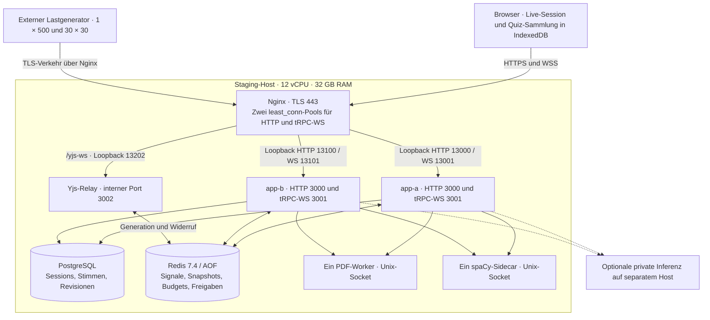
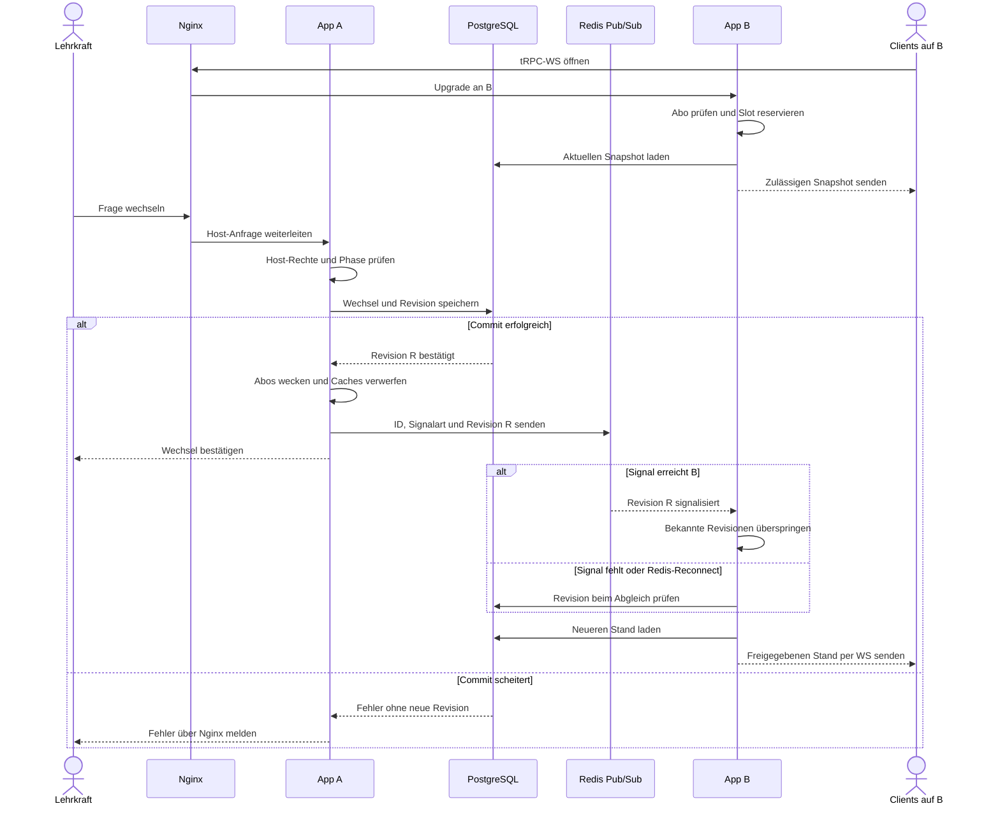
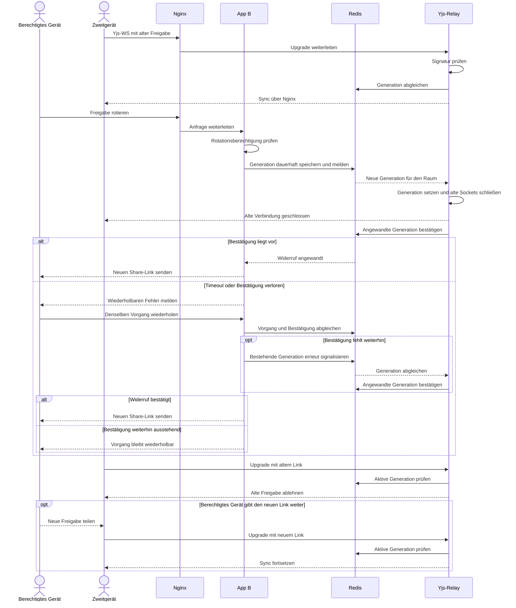
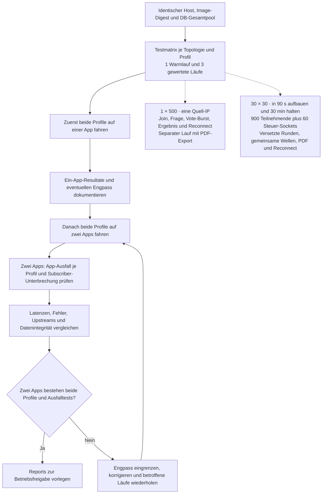
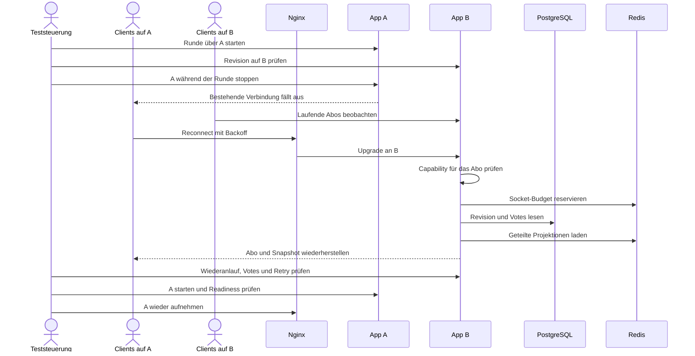
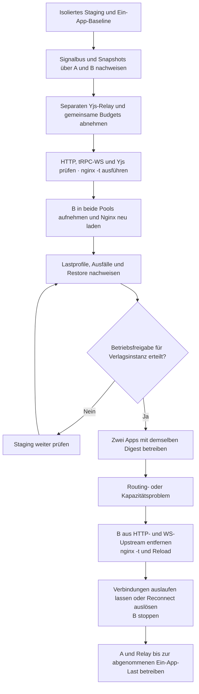

# Mehrinstanzbetrieb: aktueller Stand und Umsetzungsplan

> Stand: 2026-11-19 · Issue #428 AP7 · Umsetzungsvorschlag für einen
> Staging-Host mit 12 vCPU und 32 GB RAM.

Der reguläre Produktionsmodus startet mit einer App und eingebettetem Yjs.
Für die Abnahme stehen der [Replikabetrieb](PRODUCTION-REPLICAS.md) mit zwei
oder drei Apps und der dedizierte Yjs-Relay bereit.

## Quellen für Live-Zustände

| Zustand                                                        | Maßgebliche Quelle                                               | Recovery heute                                                                                             |
| -------------------------------------------------------------- | ---------------------------------------------------------------- | ---------------------------------------------------------------------------------------------------------- |
| Session-Status-, Teilnehmer-, Frage- und Vote-Progress-Signale | PostgreSQL-Revisionen; Fan-out über prozesslokale `EventEmitter` | Kurzer DB-Lesefallback; optionales Pub/Sub für Status und Vote-Fortschritt                                 |
| Q&A-Invalidierung (`qaQuestionsSignal`)                        | `qaRankingRevision` / Lifecycle in PostgreSQL; Signal im Prozess | Fallback 15 s (Teilnahme) bzw. 2 s (Host); Fristwecker unabhängig vom Signal                               |
| Blitzlicht-Ergebniscache                                       | Redis-Hashes der Runde; 250-ms-Prozesscache nur als Bündelung    | Nächster Poll liest Redis neu; Cache verfällt oder wird bei Fehler verworfen                               |
| Quiz-Ranglisten- und Q&A-Seitencache                           | PostgreSQL-Stimmen/Zähler; Prozesscache nach Revision/Grenze     | TTL 2 s plus Invalidation bei Vote/Purge; bei Instanzwechsel voller Reload                                 |
| Vote-Zähler- und Session-Info-Caches                           | PostgreSQL; Prozesscache                                         | `clearSessionReadCaches` / Purge; sonst TTL                                                                |
| Presenter-Fläche, Seitenkontext, Wortwolken und Q&A-Filter     | Session-Snapshot in Redis bei aktivem Replikabetrieb             | App-Wechsel und erneutes Lesen erhalten die Ansicht; konkurrierende Seitenwechsel werden atomar übernommen |
| Abschlussprojektion                                            | Separater Redis-Snapshot mit 24-Stunden-TTL                      | Nachlesen bei einem App-Wechsel                                                                            |
| Emoji-Reaktionen                                               | Redis-Hash je Session bei aktivem Replikabetrieb                 | Atomare Ersetzung je Teilnehmer, Frage und Runde; erneutes Lesen auf jeder App                             |
| Yjs-Raumbindung und Share-Provider                             | Raum-ID plus Share-Token; Provider hängt am lokalen Prozess      | Anderer Prozess kennt den Raum nicht; Clients müssen denselben Origin treffen                              |
| Presence (Tempo/Q&A-Online)                                    | Redis Sorted Sets                                                | Instanzunabhängig, sofern beide Prozesse dasselbe Redis nutzen                                             |
| Host-Pairing- und Session-Purge-Invalidierung                  | Redis Pub/Sub plus lokale Maps                                   | Vorbild für Signale; Pub/Sub allein ist kein persistenter Zustand                                          |

## 1. Zielaufbau auf einem Host

Für HTTP, tRPC-WebSockets, den separaten Yjs-Relay sowie den gemeinsamen PDF-Worker und spaCy-Sidecar steht die [versionierte Staging-Konfiguration mit Readiness und Rückweg auf App A](STAGING-COMPOSE.md) zur Verfügung. Beide Apps reservieren den Slot der optionalen privaten Inferenz gemeinsam über Redis.

Die Grafik zeigt den geplanten Staging-Aufbau. Der Lastgenerator und die
optionale private Inferenz liegen außerhalb des Testhosts.



| Pfad am Host-Nginx | Upstream auf dem Host                    | Aufgabe                         |
| ------------------ | ---------------------------------------- | ------------------------------- |
| / und /trpc        | A `127.0.0.1:13000`, B `127.0.0.1:13100` | Angular und tRPC-HTTP           |
| /trpc-ws           | A `127.0.0.1:13001`, B `127.0.0.1:13101` | Live-Subscriptions              |
| /yjs-ws            | Relay `127.0.0.1:13202`                  | Quiz-Sammlungen synchronisieren |

- Neue Staging-Compose-Variante mit `app-a` und `app-b` aus einer gemeinsamen
  Dienstvorlage. Beide starten denselben gepinnten Image-Digest mit eindeutiger
  Instanz-ID und den internen Ports 3000 und 3001. Zwei explizite Dienste
  erlauben Einzelstarts und feste Loopback-Ports. Das bestehende
  `container_name` und die festen Host-Ports verhindern direktes `--scale`.
- Beide Apps nutzen dasselbe PostgreSQL, Redis 7.4, denselben PDF-Worker
  und denselben spaCy-Sidecar.
  Der Yjs-Relay läuft als eigener Dienst. PostgreSQL und Redis bleiben im
  internen Compose-Netz. Staging bekommt eigene Volumes, Domain und Secrets.
  Innerhalb der Umgebung teilen beide Apps die Schlüssel und die öffentliche
  Origin. Falls Inferenz zum Zielprofil gehört, läuft sie für alle
  Vergleichsläufe separat und mit identischer Konfiguration.
- Migrationen und Deploy-Sweeps einmal pro Release ausführen. Den heute bei
  jedem App-Start gestarteten Session-Cleanup auf einen dedizierten Scheduler
  oder einen DB-koordinierten Lauf umstellen. Den Wechsel zur Mehrinstanz
  im Deploy-Skript und in den Smoke-Checks explizit abbilden.

### Nginx-Upstreams

Diese Blöcke ersetzen die Upstreams aus der
[Deployment-Anleitung](../deployment-debian-root-server.md). Die vorhandenen
`location`-Blöcke behalten TLS, vertrauenswürdige Forwarded-Header, WebSocket-
Upgrade und Yjs-Log-Redaktion. Vor dem Reload auf dem Zielhost `nginx -t` und
Readiness für HTTP, tRPC-WS und Yjs prüfen.

```nginx
upstream app_http {
    zone arsnova_http 64k;
    least_conn;
    server 127.0.0.1:13000 max_fails=1 fail_timeout=10s;
    server 127.0.0.1:13100 max_fails=1 fail_timeout=10s;
}

upstream app_ws_trpc {
    zone arsnova_trpc_ws 64k;
    least_conn;
    server 127.0.0.1:13001 max_fails=1 fail_timeout=10s;
    server 127.0.0.1:13101 max_fails=1 fail_timeout=10s;
}

upstream app_ws_yjs {
    server 127.0.0.1:13202;
}
```

`least_conn` verteilt neue Verbindungen. Die Zone teilt den Upstream-Zustand
zwischen Nginx-Workern. Bestehende WebSockets bleiben am gewählten Container,
bis sie sich neu verbinden. IP-Affinität würde Clients hinter Schul-NAT
zusammen auf demselben Container bündeln. Die Wiederholung bereits gesendeter
HTTP-Mutationen durch Nginx bleibt deaktiviert. Worker-Verbindungen und
Dateideskriptoren für Client- und Upstream-Sockets einschließlich
Reconnect-Überlappung dimensionieren. Upstream-Metriken aggregiert erfassen,
ohne Querystrings oder Share-Tokens zu protokollieren.
[Nginx-Upstreams](https://nginx.org/en/docs/http/ngx_http_upstream_module.html) ·
[WebSocket-Proxying](https://nginx.org/en/docs/http/websocket.html) ·
[Compose-Dienste](https://docs.docker.com/reference/compose-file/services/#container_name)

## 2. Redis, Live-Zustand und gemeinsame Budgets

Im isolierten Staging aktiviert `SESSION_STATUS_PUBSUB_ENABLED=true`
die Signale für Sessionstatus, Vote-Fortschritt, Teilnehmenden-Updates
(Join, Leave, Lesebereitschaft) und Q&A-Änderungen (Submit, Moderation,
Schwärzung, Löschen, Votes, Kanalschalter).
Beide Apps verwenden denselben internen Redis. Jede Umgebung braucht eine eigene
Redis-Instanz, weil Pub/Sub-Kanäle alle logischen Datenbanken erreichen. Ein
Signal enthält die Herkunfts-ID und den Sessioncode beziehungsweise bei
Q&A die Session-ID. Es weckt lokale Abos nach dem Commit. Die lesende App
lädt den Stand über den bestehenden Cache- und PostgreSQL-Pfad neu.
Vote-Signale nutzen ein gemeinsames Redis-Fenster von rund 150 ms pro Session.
Die reservierende App veröffentlicht und gibt das Fenster atomar frei.
Ein späterer Commit kann wieder ein Fenster öffnen. Teilnehmenden-Signale und
hochfrequente Q&A-Aktionen (Submit, Votes) bündeln pro App und Session über
50 bzw. 150 ms; moderative Q&A-Eingriffe und Schwärzungen publizieren sofort.
Bei Vote-Signalen verwerfen alle Apps die lokalen Vote-Aggregate. Im
Mehrinstanzmodus laufen diese Aggregate nach 5 s ab, damit das 10-s-Host-Polling
auch nach Signalverlust erneut aus PostgreSQL liest.

1. Den versionierten Redis-Signalbus mit eigener Subscriber-Verbindung
   je App verwenden. Die vier Kanäle wecken die lokalen Abos und verwerfen
   betroffene Caches. Statusänderungen wecken auch den Emitter der aktuellen
   Frage. Weitere Teilnehmenden- und Q&A-Änderungen lassen sich am selben
   Mechanismus anbinden. Nutzdaten und fachliche Revisionen kommen aus den
   bestehenden tRPC-Lesepfaden mit ihren jeweiligen Berechtigungen.
2. Pro Zustand die autoritative Quelle und deren Revision festlegen. Doppelte
   und verspätete Ereignisse anhand der fachlichen Revision behandeln.
   Presenter-Fläche, Seitenkontext, Q&A-Filter und Wortwolken liegen als
   gemeinsamer Session-Snapshot in Redis. Die Abschlussprojektion verwendet
   einen eigenen Redis-Snapshot. Die Apps signalisieren einen Presenter-Wechsel
   nach dem Speichern. Reaktionen werden je Teilnehmer, Frage und Runde
   atomar ersetzt. Die Session-Bereinigung löscht den Presenter-Snapshot und
   die Reaktionen gemeinsam und verhindert verspätete Schreibzugriffe.
3. Bei Einstieg auf B und nach Subscriber-Reconnect den neuesten Snapshot
   laden. Pub/Sub-Signale sind flüchtig. Den vorhandenen Revisionsfallback
   auch für einen erfolgreichen Commit mit fehlgeschlagenem Publish testen.
   AOF und bestehende `WAITAOF`-Pflichten gemäß Produktions-Compose
   beibehalten. Bei Redis-Ausfall gelten die vorhandenen Regeln für
   Berechtigungen, Widerrufe und Persistenz.
   [Redis-Zustellsemantik](https://redis.io/docs/latest/develop/pubsub/#delivery-semantics)
4. Mit `DATABASE_POOL_MAX=30` je App beginnen. 60 mögliche Verbindungen
   lassen Reserve für Betrieb und Migrationen gegenüber dem üblichen
   PostgreSQL-Limit von 100. Poolwartezeiten messen. Für einen kontrollierten
   Ein-App-Vergleich denselben Gesamtpool von 60 verwenden und die Abweichung
   vom aktuellen Default 40 im Bericht angeben.
5. **Einen gleichzeitig aktiven PDF-Auftrag** über beide Apps koordinieren.
   Staging verwendet eine verlängerbare Redis-Reservierung und einen
   isolierten Worker mit einem Render-Slot. Bei unklarem Auftragsende
   übernimmt die Ablaufzeit die Freigabe. [Staging-Betrieb](STAGING-COMPOSE.md#gemeinsamer-pdf-export-slot)
   Gemeinsame WebSocket- und Reconnect-Budgets über Redis koordinieren,
   einschließlich Limits je Session und Teilnehmer. Atomare Reservierungen,
   Freigabe bei Close und Ablauf bei Prozessverlust vorsehen. Lokale Caps
   bleiben als zweite Schranke je Prozess. Für Staging zunächst 1.200 Sockets
   je App, 2.100 global, 1.100 je Session und zwei je Teilnehmer-Tupel
   ansetzen. Die 2.100 berücksichtigen zwei Kohorten mit je 900 Teilnehmenden
   und 60 Steuer-Sockets während eines Reconnects. Eine verbleibende App
   muss 960 reguläre Verbindungen aufnehmen können. Ablehnungen und
   Reconnect-Schieflast messen, bevor Limits für Produktion freigegeben werden.

### Fragewechsel von App A zu App B

Der Ablauf zeigt einen Fragewechsel aus PostgreSQL. Die Clients auf B
umfassen Teilnehmende und den Presenter. Für Redis-gestützte Projektionen geht der versionierte
Snapshot-Schreibvorgang der Benachrichtigung voraus.



## 3. Yjs als eigener Dienst

Der dedizierte Relay und der bestätigte Widerruf sind in der [Staging-Konfiguration](STAGING-COMPOSE.md#yjs-relay-und-token-rotation) umgesetzt. Die Abnahme auf dem Zielhost folgt dem unten beschriebenen Ablauf.

- Der `YjsRelayServer` startet aus demselben Image mit eigenem Einstiegspunkt,
  Readiness und geordnetem Shutdown. Beide App-Prozesse starten HTTP
  und tRPC-WebSockets. Der Relay bindet intern Port 3002 und ist über den
  bisherigen Browser-Pfad `/yjs-ws` erreichbar.
- Erstellen und Rotieren von Share-Links verbleiben in den tRPC-Routern beider
  Apps. Der Relay verwendet dieselben Redis-Metadaten und Schlüssel. Bestehende
  Regeln für Tokenprüfung, Widerruf, Raum- und Bytebudgets gelten weiter.
  Im Mehrinstanzmodus läuft der Widerruf über Redis mit Bestätigung des Relays.
  Der Relay aktualisiert
  die Generation und beendet ältere, bereits offene Sockets. Die Rotation
  erhält erst nach dauerhaft gespeicherter Generation und Relay-Bestätigung
  eine Erfolgsantwort. Bei ausstehender Bestätigung setzt ein erneuter Aufruf die
  gespeicherte Generation fort. Bei einem Verlust des Redis-Abos schließt der
  Relay seine Sockets. Bei neuen Upgrades prüft er die aktuelle Generation aus Redis.
- Zielhost-Abnahme mit zwei Browsern in derselben Sammlung. Link über A erstellen,
  über B rotieren und alten sowie neuen Token am Relay prüfen. Bestehende
  Sockets der alten Generation müssen vor der Erfolgsantwort geschlossen
  sein. Rotation bei unterbrochenem Signalpfad und anschließendem Retry
  ebenfalls prüfen. App A stoppen
  und den laufenden Sync beobachten. Danach den Relay separat neu starten und
  Konvergenz einschließlich Offline-Änderungen anhand der Yjs-State-Vectoren
  prüfen. `load:yjs:sync` und `load:yjs:token-reconnect` mit
  `YJS_WS_URL=wss://staging.example.invalid/yjs-ws` ergänzen die Abnahme.
  Beim Token-Smoke die Clientzahl an das konfigurierte Raumlimit anpassen.

### Freigabe rotieren und offene Yjs-Verbindungen widerrufen

Das berechtigte Gerät kann die Rotation per HTTP über jede App anfordern.
Der Yjs-Datenstrom läuft dabei über denselben Relay.



## 4. Lasttest auf dem Zielhost

Zuerst **eine App**, anschließend **zwei Apps** hinter Nginx vergleichen. Pro
Profil und Topologie einen Warmlauf und drei gewertete Läufe mit frischen
Sessions fahren. Image, Host, Gesamtpool, Datenprofil und Feature-Flags
vergleichbar halten. TLS-Verkehr geht über Nginx, der Lastgenerator läuft
außerhalb des Zielhosts. Isolierte Diagnoseziele für A und B dienen dem
gezielten Routing im Integrationstest und der Messung pro Replikat. Für
`30 × 30` den Klassenstart sowohl aus einer gemeinsamen Quell-IP als auch
mit auf mehrere Schulnetze verteilter Last abbilden. Für den formalen
§6.5-Lauf die Prozess- und Abhängigkeitsproben des Orchestrators um beide
App-Replikate erweitern. Eine gesunde App allein reicht als Laufnachweis für
den Zweireplikatbetrieb nicht aus.

| Profil      | Verkehr                                                                                                                                                                                                                                                                                                                                     | Ausführung                                                                                                                                                                                                                                                                                                                                                                                                                                |
| ----------- | ------------------------------------------------------------------------------------------------------------------------------------------------------------------------------------------------------------------------------------------------------------------------------------------------------------------------------------------- | ----------------------------------------------------------------------------------------------------------------------------------------------------------------------------------------------------------------------------------------------------------------------------------------------------------------------------------------------------------------------------------------------------------------------------------------- |
| **1 × 500** | 500 Teilnehmende von derselben Quell-IP, Host und Presenter separat. Join-Welle, 500 aktive WS-Clients, Fragewechsel, Vote-Burst, Ergebnis und koordinierter Reconnect. Ein separater Durchgang überlagert den Burst mit einem PDF-Export.                                                                                                  | Vorhandene Runner nach [§6.5](../implementation/S6.5-SECURITY-LOAD-ACCEPTANCE.md) verwenden. `load:artillery:500`, `load:artillery:reconnect:500`, `load:k6:hotpaths` für den Burst und `load:pdf-vs-voting:500`. Report gegen die §6.5-Grenzen auswerten.                                                                                                                                                                                |
| **30 × 30** | 30 Sessions mit je 30 Teilnehmern, Host und Presenter. In 90 s aufbauen und 30 min halten. Sechs versetzte und vier koordinierte Fragerunden, darunter 900 Votes binnen 2 s. Je fünf Klassen wechseln zwischendurch zu Q&A und Blitzlicht. Einen Burst mit aktivem PDF-Export wiederholen, danach koordinierter Reconnect aus zehn Klassen. | Neuen Runner `scripts/load/multi-classroom-30x30.mjs` mit der bestehenden [tRPC-Testbibliothek](../../scripts/load/lib/trpc-runtime.mjs) und dem [Kanal-Fan-out-Smoke](../../scripts/load/channel-ws-fanout-classroom-30.mjs) als Vorlage implementieren. Eine Barriere bestätigt 900 Teilnehmer- und 60 Steuer-Sockets vor den gemeinsamen Wellen. Der Runner prüft Ergebnisse je Session und räumt seine Sessions auch bei Abbruch auf. |

Vorgeschlagene Staging-Grenzen für **30 × 30**. Die Grenzwerte für **1 × 500**
stehen in §6.5. Alle gewerteten Zweireplikatläufe müssen beide App-Container
als aktive Upstreams nachweisen.

| Messung                           | Grenzwert                                                                                                                                                                       |
| --------------------------------- | ------------------------------------------------------------------------------------------------------------------------------------------------------------------------------- |
| Join und Vote ohne PDF-Last       | Je Pfad p95 < 1 s, p99 < 2 s, Fehlerquote < 0,5 %                                                                                                                               |
| Vote mit einem aktiven PDF-Export | p95 < 1,5 s, p99 < 3 s, Fehlerquote < 1 %                                                                                                                                       |
| WS und Host-Status                | Mindestens 99 % verbunden in stabilen Phasen. Host-Status p95 ≤ 1,5 s, p99 ≤ 3 s                                                                                                |
| Reconnect                         | Mindestens 95 % der betroffenen Clients innerhalb von 30 s mit korrekter Revision wieder nutzbar                                                                                |
| Fachliche Korrektheit             | Bestätigte Stimmen genau einmal in der richtigen Session. Keine vorzeitigen Lösungen oder fremden Session-Ereignisse. Konsistente Ergebnisse, Q&A- und Blitzlicht-Projektionen. |

### Vergleichsläufe und Entscheidung



**Ausfalltests in separaten Durchgängen.** Host auf A und Teilnehmende sowie
Presenter auf B platzieren. Fragewechsel prüfen, dann A mitten in einer Runde
stoppen. Verlorene Verbindungen müssen auf B wieder den richtigen Stand
erreichen. Bestätigte Votes abgleichen und eine unterbrochene Aktion über
ihren regulären Idempotenzpfad erneut senden. Beide Lastprofile mit App-Ausfall
prüfen, anschließend A wieder zuschalten. Separat den Redis-Subscriber
unterbrechen und den Revisionsabgleich testen. Die Integrationstests decken
außerdem Token-Widerruf zwischen A und B, Q&A-Frist, Scorecard/Leaderboard und
die Effective-Vote-Regel ab.

### Lokaler Vergleich mit einer und zwei Apps am 19. November 2026

Beide Aufbauten nutzten dasselbe App-Image, Nginx mit HTTPS und WSS sowie
aktiviertes Redis Pub/Sub. Der Gesamtpool für PostgreSQL blieb bei 60
Verbindungen (`1 × 60` bzw. `2 × 30`). Alle Staging-Container liefen auf
denselben acht freigegebenen CPUs der lokalen Docker-VM mit 7,65 GiB RAM. Der
Lastgenerator lief auf demselben Rechner außerhalb der VM. Das Limit für
WebSocket-Upgrades wurde für die aufeinanderfolgenden Messläufe in beiden
Aufbauten auf 6.000 pro Minute gesetzt.

Pro Aufbau und Profil gab es einen Warmlauf und drei gewertete Läufe mit
frischen Sessions. `1 × 500` startete alle Join-Aufrufe gleichzeitig und hielt
502 WebSockets offen. `30 × 30` mischte die Joins der Klassen mit bis zu 96
laufenden Aufrufen und hielt 960 WebSockets offen. Die Tabelle zeigt den Median
der drei Lauf-p95. Der Host-Zeitwert reicht vom Start der Abstimmungswelle bis
zum vollständigen Stimmenstand auf dem Host-WebSocket.

| Profil  | Messung p95                         | Eine App | Zwei Apps | Änderung |
| ------- | ----------------------------------- | -------: | --------: | -------: |
| 1 × 500 | Join                                | 1.043 ms |  1.107 ms |     +6 % |
| 1 × 500 | Vote, gemeinsame Welle              | 1.029 ms |    924 ms |    −10 % |
| 1 × 500 | Vollständiger Host-Stand            | 1.139 ms |  1.048 ms |     −8 % |
| 30 × 30 | Join                                |   266 ms |    252 ms |     −5 % |
| 30 × 30 | Vote, gemeinsame Welle              | 1.942 ms |  1.576 ms |    −19 % |
| 30 × 30 | Vollständiger Host-Stand            | 2.243 ms |  1.726 ms |    −23 % |
| 30 × 30 | Vote, versetzte Klassenstarts       | 1.032 ms |    597 ms |    −42 % |
| 30 × 30 | Host-Stand, versetzte Klassenstarts | 1.173 ms |    740 ms |    −37 % |

Bei `30 × 30` sank die Dauer der gesamten Join-Welle von 1.733 auf 1.385 ms
(−20 %). Bei `1 × 500` lagen die einzelnen Join-p95 mit einer App zwischen
985 und 1.074 ms und mit zwei Apps zwischen 943 und 1.334 ms. Zwei von drei
Läufen mit zwei Apps lagen damit über der Join-Grenze von 1 s. Bei der
gemeinsamen Welle mit 900 Stimmen lagen mit zwei Apps sowohl Vote-p95 über
1 s als auch Host-p95 über 1,5 s. Bei den um 25 ms pro Klasse versetzten
Abstimmungsstarts blieben beide Kennzahlen unter diesen Grenzen.

Je Aufbau wurden 4.200 Joins und 13.800 Stimmen ohne Fehler bestätigt. Der
Reconnect lieferte in beiden Aufbauten den aktuellen Ergebnisstand für alle
500 bzw. 300 neu verbundenen Teilnehmenden. Nginx verteilte im Zweireplikatlauf
die Joins 2.130 zu 2.070, die Stimmen 6.900 zu 6.900 und die WebSocket-Upgrades
2.589 zu 2.597 auf App A und B. Für Apps, Nginx, Redis und PostgreSQL wurden
keine Container-Neustarts und keine Speicherabbrüche registriert.

| Profil  | CPU-Spitze, eine → zwei Apps | Container-RAM-Spitze, eine → zwei Apps |
| ------- | ---------------------------: | -------------------------------------: |
| 1 × 500 |            2,99 → 5,22 Kerne |                        1,69 → 2,19 GiB |
| 30 × 30 |            3,74 → 5,80 Kerne |                        1,74 → 2,30 GiB |

Die Ressourcenwerte sind Stichprobenmaxima über alle Staging-Container, ohne
VM- und Lastgenerator-Overhead. Dauerlast über 30 Minuten, paralleler
PDF-Export und Ausfallläufe bleiben Teil der Betriebsabnahme auf dem Zielhost.

### Nachmessung des 500er-Joins

Im ersten Vergleich lagen die Join-p95 der drei Läufe mit einer App bei 985,
1.043 und 1.074 ms, mit zwei Apps bei 943, 1.334 und 1.107 ms. Im Nginx-Log
lagen die Mediane der Lauf-p95 bei 934 ms mit einer und 871 ms mit zwei Apps.
Der Abstand von 64 ms am Lastgenerator lag innerhalb der Schwankung der
einzelnen Läufe.

In einer getrennten Diagnosebeobachtung warteten bei zwei Apps zeitweise bis
zu 15 Verbindungen auf die globale Rekordzeile und bis zu 12 auf die
Tagesrekordzeile. In jeder App liefen Rekordupdates und Joins über denselben
lokalen Pool. Jeder Join startete zuvor zwei solche Schreibvorgänge. In der
Diagnose lag der Median der Lauf-p95 für die Vorbereitung der Teilnahme
bei 181 ms mit einer App und 336 ms mit zwei Apps. In dieser Phase liegen
auch das Warten auf den Pool und der Schreibpfad unter dem Session-Lock.

Rekordupdates werden nun je App und UTC-Tag auf das höchste ausstehende
Maximum verdichtet. Bestehende atomare Updates sichern den Rekord über beide
Apps hinweg. Beim sauberen Stopp verarbeitet die App die ausstehenden Werte
vor dem Schließen des Datenbankpools. Eine Join-Welle teilt sich je App nur
die laufende, auf Join-Felder begrenzte Session-Abfrage. Zulassung und Ablauf
werden pro Anfrage geprüft. Der Abgleich nach dem Schreiben zählt
Teilnehmende nur dann, wenn er noch ein AUTO-Team zuweisen muss.

Die Nachmessung verwendete Nginx mit HTTPS/WSS, Redis Pub/Sub, dieselbe
Docker-VM und denselben PostgreSQL-Gesamtpool wie der erste Vergleich. Auch
der neue Build wurde in beiden Topologien identisch eingesetzt.

| Topologie | Vorher, Median der Join-p95 | Nachher, Join-p95 je Lauf | Nachher, Median | Änderung |
| --------- | --------------------------: | ------------------------: | --------------: | -------: |
| Eine App  |                    1.043 ms |        695 / 734 / 993 ms |          734 ms |    −30 % |
| Zwei Apps |                    1.107 ms |        633 / 747 / 677 ms |          677 ms |    −39 % |

Alle sechs gewerteten Läufe unterschritten 1 s p95. Mit zwei Apps lag der
Median 8 % unter dem der Ein-App-Topologie. Der erste Lauf nach dem Start der
Container lag bei 1.536 ms mit einer und 1.029 ms mit zwei Apps. Vor dem
Senden der HTTP-Header vergingen in diesem ersten Lauf am Lastgenerator
310 bzw. 264 ms p95. Nginx maß für die Antwort-Header des Upstreams
1.190 bzw. 725 ms p95.

Die 30-×-30-Kontrollläufe lagen bei 218 ms Join-p95 mit einer und 167 ms mit
zwei Apps. In beiden Topologien bestätigte der Runner 4.200 Joins und 13.800
Stimmen ohne Fehler und prüfte den vollständigen Ergebnisstand nach dem
Reconnect. Nginx leitete 2.171 Joins an App A und 2.029 an App B. PostgreSQL
speicherte je Topologie sowohl für den globalen Rekord als auch für den
UTC-Tagesrekord 500 Teilnehmende.

### Erster 500er-Burst nach Containerstart

Für den Kaltstart entstanden je Durchgang frische Container und Testdaten.
Nach Readiness und Sessionanlage startete der externe macOS-Lastgenerator
alle 500 Join-Aufrufe innerhalb von 8 bis 12 ms. Jede bestätigte Teilnahme
öffnete sofort ihren WebSocket. Nginx, PostgreSQL und Redis Pub/Sub liefen
mit derselben CPU-Freigabe und demselben Gesamtpool wie beim bisherigen
Vergleich. In beiden Aufbauten kamen 500 Joins, 500 Stimmen und 502
WebSockets fehlerfrei an.

| Messabschnitt p95                                   | Eine App | Zwei Apps |
| --------------------------------------------------- | -------: | --------: |
| Ende-zu-Ende-Join                                   | 1.263 ms |  1.049 ms |
| Client bis zum Senden der Request-Header            |   276 ms |    274 ms |
| Nginx bis zum Eingang im Express-Handler            |   897 ms |    606 ms |
| Eingang im Express-Handler bis zum Ende der Antwort |   120 ms |    151 ms |

Die Perzentile sind je Abschnitt berechnet. Eine gesonderte Messung mit einer
App zeigte 854 ms p95 bis zur Annahme des Upstream-Sockets in Node und 21 ms
p95 von der Socket-Annahme bis zum Express-Handler. Der Event-Loop war während
des Bursts durchgehend ausgelastet. Die Linux-Zähler für verworfene
Listen-Queue-Einträge blieben bei null.

Vier Nginx-Worker mit getrennten Listen-Sockets, ein Readiness-Warmup für
PostgreSQL und HTTP sowie das gedrosselte Weiterreichen der WebSocket-Upgrades
lagen auf der Ein-App-Topologie jeweils über 1 s p95. Die Join-Antworten ohne
Kompression erreichten 1.227 bzw. 996 ms. Ein Kontrolllauf mit separatem
Lastgenerator in der Docker-VM und HTTPS direkt an Nginx erreichte auch ohne
macOS-Portweiterleitung 1.200 bzw. 1.059 ms.

Als Diagnose mit erst nach allen Join-Antworten geöffneten Teilnehmer-WebSockets
sank der p95 von 1.237 auf 970 ms. Bei sofort geöffneten WebSockets erreichte
keine der geprüften Änderungen das Ziel in beiden Topologien. Das
Kaltstart-Gate für diesen Ablauf bleibt offen.

### Lokaler Vergleich mit zwei und drei Apps bei 30 × 30

Beide Aufbauten verwendeten dasselbe App-Image, Nginx mit HTTPS/WSS, Redis
Pub/Sub und insgesamt 60 PostgreSQL-Verbindungen. Zwei Apps bekamen je 30
Verbindungen, drei Apps je 20. Die Container nutzten dieselben acht CPUs in
der lokalen Docker-VM mit 7,65 GiB RAM. Der Lastgenerator lief auf demselben
Rechner außerhalb der VM. Die Lasttests auf einem dedizierten
8-vCPU-/16-GB-Staging stehen aus.

Pro Aufbau gab es einen Warmlauf und drei gewertete Läufe mit frischen
Sessions, je 900 Teilnehmenden und 960 WebSockets. Jeder gewertete Lauf
enthielt zwei gemeinsame Wellen mit je 900 Stimmen und zwei um 25 ms pro
Klasse versetzte Runden. Die Latenzen sind Mediane der drei Lauf-p95. Der
vollständige Host-Stand wird ab dem Versand der Stimmen bis zum letzten
Stimmenstand der jeweiligen Klasse auf dem Host-WebSocket gemessen.

| Messung bei 30 × 30                                 | Zwei Apps | Drei Apps |
| --------------------------------------------------- | --------: | --------: |
| Vote-p95, gemeinsame Wellen                         |  1.336 ms |  1.242 ms |
| Vollständiger Host-Stand p95, gemeinsame Wellen     |  1.470 ms |  1.373 ms |
| Host-p95 ab letzter Vote-Antwort, gemeinsame Wellen |    134 ms |    113 ms |
| Vote-p95, versetzte Wellen                          |    282 ms |    363 ms |
| Vollständiger Host-Stand p95, versetzte Wellen      |    448 ms |    545 ms |
| CPU-Mittel, gemeinsame Wellen                       |      42 % |      59 % |
| CPU-Spitze, gesamter gewerteter Lauf                |      61 % |      83 % |
| Container-RAM-Spitze                                |  2,25 GiB |  2,75 GiB |

CPU-Werte addieren alle Staging-Container, beziehen sich auf acht CPUs und
stammen aus Stichproben im 500-ms-Takt. Je Aufbau liefen 2.700 Joins und
10.800 Stimmen in den gewerteten Läufen fehlerfrei. In der Drei-App-Variante
gingen 3.579, 3.596 und 3.625 Votes an A, B und C. Die 2.880
WebSocket-Verbindungen verteilten sich gleichmäßig auf die drei Apps.

#### CPU-Mehrarbeit und Wartezeit beim Abstimmen

Bei versetzten Wellen stieg der Nginx-p95 bis zu den Antwort-Headern der
App von 271 auf 344 ms. Beim Wechsel von zwei auf drei Apps stieg der
CPU-Verbrauch der App-Container im Mittel von 1,23 auf 1,69 Kerne und der von
PostgreSQL von 0,84 auf 0,96 Kerne. Nginx und Redis trugen zusammen rund
0,02 zusätzliche Kerne bei. Die Verzögerung war bereits im HTTP-Upstream
vor dem WebSocket-Update des Hosts sichtbar.

Ein separater instrumentierter Nachlauf zählte bei je 5.400 Votes in den
versetzten Wellen folgende Backend-Vorgänge.

| Vorgang                                                      | Zwei Apps | Drei Apps |
| ------------------------------------------------------------ | --------: | --------: |
| PostgreSQL-Lookups für Teilnahme-Capabilities                |       999 |     1.966 |
| Nachladungen der Frage in den lokalen Cache                  |       360 |       539 |
| Empfangene Vote-Signale von anderen Apps                     |       501 |     1.088 |
| Neuberechnungen des Vote-Aggregats                           |       511 |       528 |
| Outbox-Versuche ohne Verarbeitung, Zeile bereits verarbeitet |       350 |       600 |

In beiden Fällen verarbeiteten die Statistik-Consumer in diesen Fenstern
350 Outbox-Zeilen erfolgreich. Jeder Prozess lädt zunächst anstehende
Zeilen und beansprucht sie in Einzeltransaktionen per `FOR UPDATE`. Ein
anderer Consumer kann beim selben Eintrag warten und nach Freigabe ohne
Änderung abbrechen. Im Drei-App-Profil warteten PostgreSQL-Verbindungen
unter anderem auf Outbox-Zeilensperren und zeitweise bis zu 59 Verbindungen
gleichzeitig auf `WALWrite`. Die Dauer des Shared-Lock-Aufrufs im
fachlichen Vote-Pfad lag in beiden Aufbauten bei rund 10 ms p95.

Die Mehrarbeit war auch mit Instrumentierung sichtbar. Die Rangfolge des
Vote-p95 bei versetzten Wellen wechselte in diesem Nachlauf (622 ms mit
zwei Apps, 358 ms mit drei). Bei den gemeinsamen Wellen stiegen die
Neuberechnungen der Vote-Aggregate im Profillauf von 684 auf 1.043.

In einer Gegenprobe liefen weiterhin drei Apps und die Vote-Transaktionen
schrieben ihre Outbox-Ereignisse wie zuvor. Ein einzelner aktiver
Statistik-Consumer beseitigte die konkurrierenden Outbox-Sperrversuche.
Während der versetzten Wellen fiel ihre Zahl von 600 auf null. Die
CPU-Spitze über den Test sank von 6,48 auf 6,09 Kerne, der Mittelwert blieb
mit 3,37 bzw. 3,39 Kernen nahezu gleich. Der Vote-p95 der versetzten
Wellen stieg in dieser Gegenprobe von 358 auf 712 ms. PostgreSQL meldete
weiterhin punktuelle Wartezeiten auf das Write-Ahead-Log. Die Wahl eines
einzelnen Consumers beseitigte damit einen gemessenen Lock-Konflikt. Die
Vote-Latenz blieb zwischen den Läufen variabel.

#### Nachmessung mit gemeinsamem Vote-Fenster

`vote.submit` lädt den Teilnehmer und seine Session bei einem Cache-Miss
in der Abfrage, die auch den Hash des Teilnahme-Tokens prüft. Bei einem
Cache-Treffer bleibt die Reihenfolge von Rate-Limit und Kontextabfrage
erhalten. Redis reserviert beim Vote-Fortschritt je Session ein gemeinsames
Fenster für die Apps. Ein separater Test mit zwei Redis-Sendern bestätigte
ein Signal für parallele Auslöser und ein neues Signal für einen späteren
Commit. Beide Listener empfingen beide Signale.

Gemessen wurde erneut im lokalen Staging auf acht freigegebenen CPUs bei
7,65 GiB Docker-VM-RAM. Zwei Apps nutzten 2 × 30 DB-Verbindungen, drei
Apps 3 × 20. Je Aufbau wurden ein Warmlauf und drei Läufe mit je zwei
gemeinsamen und zwei um 25 ms pro Klasse versetzten Vote-Wellen gefahren.
Die Latenzwerte zeigen die Mediane der Lauf-p95. Die CPU-Werte addieren
alle Staging-Container und beziehen sich auf acht CPUs.

| Messung bei 30 × 30                                        | Zwei Apps |   Drei Apps |
| ---------------------------------------------------------- | --------: | ----------: |
| Vote-p95, gemeinsame Wellen                                |  1.491 ms |    1.253 ms |
| Vollständiger Host-Stand p95, gemeinsame Wellen            |  1.608 ms |    1.376 ms |
| Host-p95 ab letzter Vote-Antwort, gemeinsame Wellen        |    140 ms |      152 ms |
| Vote-p95, versetzte Wellen                                 |    351 ms |      802 ms |
| Vollständiger Host-Stand p95, versetzte Wellen             |    492 ms |      938 ms |
| Host-p95 ab letzter Vote-Antwort, versetzte Wellen         |    215 ms |      203 ms |
| CPU-Mittel, gemeinsame Wellen                              |      40 % |        52 % |
| CPU-Mittel, versetzte Wellen                               |      32 % |        39 % |
| CPU-Spitze, gesamte gewertete Läufe                        |      60 % |        78 % |
| Vote-Signale über alle gewerteten Wellen, vorher → nachher | 984 → 515 | 1.320 → 590 |

In beiden Aufbauten bestätigte der Runner 10.800 Stimmen fehlerfrei.
Nginx verteilte die Stimmen unter drei Apps auf 3.605, 3.583 und 3.612.
In der frischen Drei-App-Kontrolle mit dem vorherigen Image lagen die
gemeinsamen Wellen bei 1.259 ms Vote-p95, 1.380 ms für den vollständigen
Host-Stand und 56 % mittlerer CPU-Auslastung. In den versetzten Wellen
lagen sie bei 247 ms Vote-p95, 394 ms für den vollständigen Host-Stand und
39 % mittlerer CPU-Auslastung. Das neue Image publizierte im Vergleich
zu dieser Kontrolle 590 statt 1.352 Vote-Signale.

Die zusätzliche Verzögerung der versetzten Wellen war schon in der
Antwortzeit des Nginx-Upstreams sichtbar. Mit der zusammengelegten
Token-Abfrage und dem bisherigen Pub/Sub lag der Vote-p95 bei 316 ms.
Eine Gegenprobe mit dem gemeinsamen Fenster und ohne AOF-Schreibvorgänge
für dessen Reservierung lag bei 571 ms. Die Gegenproben deuten auf den
Pfad mit gemeinsamem Fenster. Welcher Teil dieses Pfads die zusätzlichen
Wartezeiten verursacht, blieb offen.

#### Profilierung und Korrektur des Vote-Fensters

Im Drei-App-Profil konkurrierten die schreibenden Apps um dieselbe
Reservierung. Jede App konnte nach 10 ms erneut anfragen, während die
Reservierung der anderen App typischerweise noch 140 ms offen war. Das
erzeugte bei 5.400 Stimmen in versetzten Wellen 1.164 abgewiesene
Redis-Reservierungen. Auf demselben Redis wartete der HTTP-Pfad je
zugelassener Stimme auf vier aufeinanderfolgende Rate-Limit-Aufrufe.

Die Apps sammeln jetzt 75 ms lokale Commits, bevor sie das Fenster
reservieren. Die App mit der Reservierung veröffentlicht nach weiteren
75 ms. Das Vote-Rate-Limit liest und bucht das bestehende Redis-Budget
atomar mit einem Aufruf. Redis bestimmt den Fensterbeginn mit seiner
Serverzeit, auch wenn parallele Anfragen in anderer Reihenfolge eintreffen
als sie gestartet wurden. Session-Kanal und Format der Rate-Limit-Keys
bleiben kompatibel mit dem vorherigen Image. [Atomare Redis-Skripte](https://redis.io/docs/latest/develop/programmability/eval-intro/), [Redis-Serverzeit](https://redis.io/docs/latest/commands/time/)

| Drei Apps, versetzte Wellen, instrumentiert           | Vorher | Nachher |
| ----------------------------------------------------- | -----: | ------: |
| Abgewiesene Redis-Reservierungen                      |  1.164 |     479 |
| Veröffentlichte Vote-Signale                          |    314 |     380 |
| Berechnete Vote-Aggregate                             |    523 |     630 |
| Vote-p95 bis HTTP-Antwort                             | 983 ms |  601 ms |
| Vote-Resolver-p95                                     | 555 ms |  378 ms |
| p95 von Anforderung bis Start der DB-Transaktion      | 107 ms |   81 ms |
| Gleichzeitige PostgreSQL-Waits auf `WALWrite`, Spitze |     43 |       8 |

Die Antwortzeit sank bei geringerem Redis-Koordinationsaufwand und trotz
zusätzlicher Aggregatabfragen. Redis lag in beiden Profilen im Mittel
bei rund 0,1 CPU-Kernen. Wartezeiten im PostgreSQL-Pool und beim
WAL-Schreiben traten weiterhin auf. Die Profile messen die erste
kombinierte Korrektur mit App-Zeitstempeln. Ein anschließender
Drei-Prozess-Smoke mit Redis-Serverzeit bestätigte die atomare Zulassung
und eine Sekunde Wartezeit bei Überschreitung für die Limits eins und
zwei.

Die abschließende Messung ohne Instrumentierung lief in derselben lokalen
Docker-VM mit acht freigegebenen CPUs und 7,65 GiB RAM. Je Aufbau liefen
ein Warmlauf und drei gewertete Läufe mit jeweils zwei gemeinsamen und
zwei um 25 ms pro Klasse versetzten Vote-Wellen. Die Werte sind die
Mediane der Lauf-p95. Die CPU-Werte addieren alle Staging-Container.

| 30 × 30 mit korrigiertem Vote-Fenster               | Zwei Apps (2 × 30) | Drei Apps (3 × 20) |
| --------------------------------------------------- | -----------------: | -----------------: |
| Vote-p95, gemeinsame Wellen                         |           1.622 ms |           1.252 ms |
| Vollständiger Host-Stand p95, gemeinsame Wellen     |           1.833 ms |           1.419 ms |
| Host-p95 ab letzter Vote-Antwort, gemeinsame Wellen |             145 ms |             147 ms |
| Vote-p95, versetzte Wellen                          |             507 ms |             269 ms |
| Vollständiger Host-Stand p95, versetzte Wellen      |             714 ms |             450 ms |
| Host-p95 ab letzter Vote-Antwort, versetzte Wellen  |             271 ms |             215 ms |
| CPU-Mittel, gemeinsame Wellen                       |               43 % |               51 % |
| CPU-Mittel, versetzte Wellen                        |               28 % |               32 % |
| CPU-Spitze, gesamte gewertete Läufe                 |               65 % |               80 % |
| Vote-Signale, gesamte gewertete Läufe               |                679 |                574 |

In beiden Aufbauten kamen je 10.800 Stimmen und alle vollständigen
Host-Stände fehlerfrei an. Bei drei Apps sank der Vote-p95 der
versetzten Wellen gegenüber dem vorherigen gemeinsamen Fenster von
802 auf 269 ms, der vollständige Host-Stand von 938 auf 450 ms. Der
frühere Kontrolllauf mit drei Apps und dem ursprünglichen Pub/Sub
lag für versetzte Wellen bei 247 ms Vote-p95. Mit zwei Apps lag der
Vote-p95 der versetzten Wellen im vorherigen Lauf bei 351 ms und in
dieser Messung bei 507 ms. Der separate Host-Progress-Smoke mit
200 Stimmen erreichte 507 ms Vote-p95 und vier
Fortschrittsnachrichten, darunter den vollständigen Stand.

### App-Ausfall in einer aktiven Runde



**Report je Phase und Klasse.** Join-, Vote-, Status- und Reconnect-Latenzen,
Fehler einschließlich unerwarteter 429, Upstream-Verteilung, aktive Sockets,
Reconnect-Überlappung und verspätete Revisionen erfassen. CPU, RSS und
Event-Loop-Lag je App sowie Host-CPU, Netzwerk, Datenträger, DB-Poolwartezeit
und Redis-Latenz messen. Digest und bereinigte Testkonfiguration dokumentieren.
Bei fehlender Kohorte, SLO-Verletzung, Datenintegritätsfehler oder drohender
Sättigung den Lauf abbrechen und den Grund festhalten.

## 5. Reihenfolge und Rückkehr

Die versionierten Produktionsprofile und der Topologie-Rollback stehen im
[Produktions-Runbook](PRODUCTION-REPLICAS.md). Die Abnahme auf dem Zielhost
folgt nach dem lokalen Smoke.

### Freigabe und Rückweg als Ablauf



| Schritt                  | Ergebnis für den nächsten Schritt                                                                                                                                        |
| ------------------------ | ------------------------------------------------------------------------------------------------------------------------------------------------------------------------ |
| 1. Staging               | Loopback-Portplan, isolierte Daten, Readiness für A/B und Relay. Ein-App-Baseline auf der Zielhardware.                                                                  |
| 2. Live-Zustand          | Redis-Signale, Revisionsabgleich und geteilte Projektionen. A/B-Integrationstests mit verlorenen, doppelten und verspäteten Signalen bestanden.                          |
| 3. Betrieb der Replikate | Eigener Relay, koordinierte Limits und Hintergrundläufe. Nginx nimmt B nach Readiness in HTTP- und WS-Pool auf.                                                          |
| 4. Abnahme               | Beide Lastprofile und Ausfalltests bestanden. Vergleichsberichte zeigen den Gewinn und verbleibende Engpässe.                                                            |
| 5. Verlagsbetrieb        | Betriebsfreigabe nach Durchsicht der Reports und geprobtem [Restore](BACKUP-RESTORE-RUNBOOK.md). Host, Nginx, PostgreSQL, Redis und Relay sind gemeinsame Ausfallpunkte. |

Für gestaffelte Updates die Kompatibilität von Migrationen, Live-Event-Versionen
und Frontend-Assets im Mischbetrieb belegen. Bis dahin Versionswechsel in einem
Wartungsfenster planen. Bei einem Routing- oder Kapazitätsproblem B aus beiden
Nginx-Upstreams nehmen, `nginx -t` und Reload ausführen, Verbindungen auslaufen
lassen oder kontrolliert zum Reconnect bringen und B stoppen. A und der
dedizierte Relay bedienen dann höchstens die in der Baseline abgenommene Last.
Ein Versionsrollback setzt kompatible Migrationen und Zustandsformate voraus.

Der aktuelle [Produktions-Compose](../../docker-compose.prod.yml) beschreibt
eine App. Dieses Dokument plant den Umbau. Zielhostläufe auf isoliertem Staging
und ein späterer Produktionswechsel folgen
[den bestehenden Betriebsfreigaben](../implementation/S6.5-SECURITY-LOAD-ACCEPTANCE.md).
